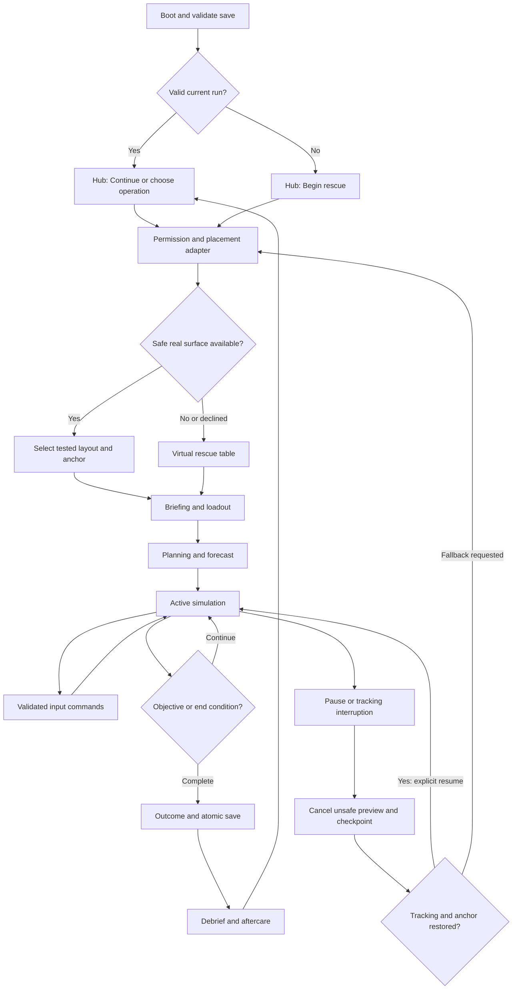

# RESQ

## Production specification & Codex handoff

**Small worlds. Big saves.**

Prepared 15 October 2026. Specification v1.0.

Five planned worlds • 25 authored mission briefs • 38 dependency-based production tasks.

This is a design and production pack, not a built game. All gameplay, hardware, assets, video and website qualification remain implementation tasks.

# Resq — decisions, assumptions, and verified constraints

Version: 1.0 • Prepared 15 October 2026 • Owner: Project creator

## Status of this delivery

This is a production specification and Codex handoff pack, not a built or tested game. It contains original product/design decisions, machine-readable mission briefs, a logical ERD, validation tooling, acceptance criteria, and a production workflow. It does not contain a playable APK, finished meshes, recorded gameplay, a published video, or a deployed website. Those deliverables must be generated and verified in the user's local Codex/Unity environment.

Numbers labeled targets are initial design or engineering budgets, not measured performance or market benchmarks. Mission events, quantities, and challenge tuning are initial authored values requiring playtesting. Machine-readable mission briefs are NOT finished scene geometry or compiled runtime levels.

## Decisions to preserve

| Decision | Specification |
|---|---|
| Working name | Resq; display wordmark RESQ; provisional subtitle “Little Worlds, Big Saves” |
| Tagline | Small worlds. Big saves. |
| Domain | playresq.com, intended future domain; ownership and availability unverified |
| Product | Seated, hands-first miniature rescue strategy game for standalone Meta Quest |
| Competition | Meta VR Start Developer Competition 2026; intended Gaming / New Experience division |
| Primary targets | Quest 3 and Quest 3S; test both before claiming support |
| Default play | Hand tracking, single-hand-completable; optional controllers |
| Additional accessibility | Head-directed selection and dwell; distinct Command mode; no eye tracking assumed |
| Presentation | Mixed reality with room-aware table placement; virtual-table fallback |
| Full-game content | Five worlds, five authored missions per world: 25 missions |
| Competition slice | World 1, all five missions, integrated tutorial, replay variations, results, save/resume |
| Runtime | Offline, deterministic game rules; no LLM dependency, mandatory login, or cloud generation |
| Build | Unity 6.3 LTS candidate + URP + a verified compatible Meta SDK combination |
| Art | Higgsfield-assisted concept/3D work; Blender as editable source and optimization stage |
| Site | Next.js/TypeScript, deployed to Vercel; Mobbin research in the user's authenticated Codex environment |
| Commercial model | Proposed premium purchase after competition; final pricing not approved |
| Submission video | 2:40 target, actual game footage; no fabricated gameplay |

## Name assessment

“Resq” is short, relates to rescue, and fits the concept. It is not a clean-sheet name: a historical video game is documented as ResQ [S18], and a designer documents a board game with that name [S19]. This is a preliminary collision check, not trademark clearance. A subtitle may improve search specificity but does not establish legal availability. Keep all game identifiers independent of the display name. Do not purchase a domain or assert ownership on the user's behalf. Before commercial launch, verify relevant game/store names and obtain appropriate name clearance in intended markets.

## Competition constraints that change implementation

The official rules require a hands-first experience and support a seated, short-session design. A Unity submission uses an APK in a Meta developer release channel called `Competition`. A public YouTube or Vimeo demo should be under three minutes and show device or emulator footage. Freeze the submission at the deadline and preserve judging access. English is required directly or through translation/subtitles. Verify eligibility, Start membership, permitted resources, and asset rights before submission. The rules warn against bot/automated entries; do not automate final entry submission or attestations. Seek organizer clarification before interpreting ambiguous originality/automation language. [S01–S04]

Deadline: **18 November 2026, 12:00 Pacific Standard Time = 20:00 UTC = 22:00 Cairo**. The earlier conversational conversion to 23:00 Cairo was incorrect. Conversion uses timezone rules for the deadline date, not today's UTC offset. [S01]

Competition judging assigns equal weight to innovation, experience design, technical implementation, and polish. Its published floor of 60 fps is not this project's production target: Meta's Quest optimization guidance gives 72 fps as its VRC minimum. Build toward sustained native 72 fps, then qualify 90 fps independently. Recheck current requirements before the final build. [S01, S08]

## Automation boundaries

Automate routine local implementation, scene assembly, asset optimization, tests, builds, website checks, and video assembly. Do not equate agent completion with evidence of correctness.

Human/account gates remain: hardware access and safe physical setup, developer mode and USB trust, Unity licensing, provider OAuth, approved spend limits, actual comfort/playability observations, footage permission, domain purchase/ownership, release approval, and final competition submission. Aggregate these gates into one startup report; continue unrelated work rather than repeatedly interrupting the owner.

No system here guarantees a win, award, commercial success, platform acceptance, or studio-equivalent quality without review.

## Tool verification notes

Higgsfield's current 3D Jutsu documentation describes editable scenes and GLB export. Connected tool definitions additionally expose committed Blender-source and GLB retrieval. That is useful for production, but does not establish Quest-ready topology, materials, licensing, rigging, or performance. Every asset still passes Blender and Unity validation. [S11, S12]

Mobbin documents an official MCP endpoint and Codex compatibility. The research connection was not usable inside this conversation: plugin discovery returned no Mobbin connector, and the alternative Refero connection reported an inactive subscription. Consequently, this pack does NOT claim that any Mobbin screens were inspected. Codex must perform and record the real reference study before implementing the site. [S13]

## Sources

Public sources were checked during preparation. Recheck live platform/competition rules before release. Tool schemas describe only the environment in which they are exposed; discover them again in Codex.

- **S01:** Competition official rules — https://start-developer-competition-26.devpost.com/rules
- **S02:** Competition FAQ — https://start-developer-competition-26.devpost.com/details/faqs
- **S03:** Competition overview — https://start-developer-competition-26.devpost.com/
- **S04:** Meta competition announcement — https://developers.meta.com/blog/meta-connect-2026-vr-start-developer-competition/
- **S05:** Unity 6 release support — https://unity.com/releases/unity-6/support
- **S06:** Meta Interaction SDK requirements — https://developers.meta.com/vr/documentation/unity/unity-isdk-packages-and-requirements/
- **S07:** Official MRUK sample overview — https://developers.meta.com/vr/documentation/unity/unity-sample-mruk-basic/
- **S08:** Meta optimization workflow — https://developers.meta.com/vr/documentation/unity/po-perf-opt-mobile/
- **S09:** Unity 6.3 command-line reference — https://docs.unity.com/en-us/engine/6000.3/manual/unity-editor/command-line-arguments/editor
- **S10:** Blender command-line reference — https://docs.blender.org/manual/en/3.0/advanced/command_line/arguments.html (flag reference; inspect installed-version documentation before use)
- **S11:** Higgsfield 3D Jutsu — https://higgsfield.ai/blog/higgsfield-3d-jutsu
- **S12:** Higgsfield MCP — https://higgsfield.ai/mcp
- **S13:** Mobbin MCP — https://mobbin.com/mcp and https://github.com/mobbin/mobbin-mcp-server
- **S14:** Codex non-interactive mode — https://learn.chatgpt.com/docs/non-interactive-mode
- **S15:** Codex AGENTS.md guidance — https://learn.chatgpt.com/docs/agent-configuration/agents-md
- **S16:** Vercel deployments — https://vercel.com/docs/deployments
- **S17:** Vercel domain documentation — https://vercel.com/docs/domains
- **S18:** Historical ResQ documentation — https://www.segaretro.org/ResQ
- **S19:** Designer's ResQ board-game page — https://www.aishwaryanarvekar.com/resq

All subsequent gameplay, numerical tuning, art choices, mission scenarios, and architecture choices are proposed Resq specifications unless explicitly attributed to a source.


---

# 01 — Product requirements document

## 1. Product definition

**Resq is a tactile rescue-strategy game where a living miniature world appears in front of your chair, and your interventions change whether its inhabitants reach safety.**

You are an operator at a fictional rescue organization, not an all-powerful giant. You may deploy equipment, redirect environmental hazards, open routes, allocate power, and dispatch vehicles. You cannot pick up people, erase hazards, or move arbitrary buildings. The player's freedom comes from combining understandable systems.

The emotional arc is: notice a small problem, make a useful intervention, see lives improve, encounter a complication, improvise, and watch the town recover. The tone is warm, ingenious, and occasionally tense. It is not a disaster-suffering simulator.

### The signature moment

A river is about to cut off a village bus. The player pinches a flood barrier from the equipment tray and places it at a marked embankment. A translucent forecast shows where the diverted water will go. On release, the barrier locks with a satisfying mechanical sound. Water redirects, a new route becomes dry, the bus moves, and tiny passengers wave as they arrive safely. One action visibly changes several systems.

The complete interaction must still be understandable without narration, a cutscene, generative dialogue, or explanatory slides.

## 2. Audience and use cases

Primary design audience: teenagers and adults who enjoy spatial puzzles, approachable strategy, miniature worlds, and short sessions. Target positioning is 13+ subject to the actual platform rating process, not a claimed rating. The game should avoid graphic injury, realistic distress audio, gambling, public chat, and manipulative retention mechanics.

A player might have ten minutes after work, limited room to move, a preference for seated play, or friends watching a cast of the headset. Another may need one-handed controls or a low-speed command interface. The primary experience must not require standing, crouching, floor interaction, large reach, eye tracking, or constant arm elevation.

### Jobs to be done

- “Give me a complete, satisfying challenge without rearranging my room.”
- “Let me understand what went wrong and improve my plan.”
- “Make me care about a place without asking me to maintain it every day.”
- “Let me use VR's depth and hands for something more interesting than pressing floating buttons.”

## 3. Design pillars and anti-slop rules

**Readable causality:** hazards announce themselves; previews explain effects; outcomes follow rules. A failure must be explainable in one sentence.

**Tactile purpose:** each gesture represents a game action. No decorative gestures, arbitrary hand spells, or fiddly interactions that are easier as buttons without adding value.

**Rescue first:** points, scenery, and unlocks support helping inhabitants. The most valuable behavior must not be allowing damage to farm rewards.

**Authored variety:** worlds change the problem structure, not just lighting or textures. Every mission has a central decision and at least two validated approaches where specified.

**Bounded spectacle:** art direction, sound, timing, and animation create richness within mobile performance budgets.

Do not add an AI chat companion, generated missions at runtime, random filler islands, currency shops, a crafting tree, multiplayer, open-world walking, dozens of currencies, or a fake social leaderboard. A tool is not a feature simply because it can be integrated.

## 4. Scope and releases

### Competition build: a finished chapter, not a menu of promises

World 1, **Alder Valley**, contains five playable missions. Mission 1 teaches the controls through a real rescue. The build includes two weather/layout modifiers, three difficulty/input presets, coherent scoring, a results screen, saved progress, pause/resume, a return visit to the rescued town, help, credits, and reliable placement recovery.

Other worlds are excluded from the playable competition menu. A roadmap can exist on the public site only when clearly labeled planned. No inactive buttons, “coming soon” gameplay destinations, or cinematic footage presented as implemented content.

If scope threatens quality, reduce the competition chapter to its three strongest finished missions and update every content claim. This is a contingency, not permission to ship five broken missions. Do not silently reduce scope; record the decision and actual release manifest.

### Full release: five worlds, 25 missions

1. Alder Valley: water routing and ground evacuation.
2. Emberwood: firebreaks, moisture, wind, and transport staging.
3. Frostline: unstable snow, structural supports, and cable rescue.
4. Tidemark: timed tides, electrical networks, and multi-leg transport.
5. Cinder Reach: slower volcanic hazards, cooling, shelter, and combined-system mastery.

Full-release implementation proceeds only after the first chapter meets its interaction, fun, and performance gates. Data schemas support all worlds from the beginning; meshes, mechanics, and missions do not all need to be built at once.

### Explicit non-goals

No PC dependency for players. No mandatory internet or account. No generative AI during gameplay. No cloud simulation. No payments inside the competition APK. No physically accurate fluid/structural simulator. No roomscale locomotion. No online multiplayer, public user-generated content, or cloud leaderboards at launch. No promise of compatibility with unreleased hardware without qualification.

## 5. Modes

**Story Operations:** standard 6–9 minute missions with authored threats, pause, forecasting, optional objectives, and chapter progression.

**Command Mode:** the same rescue systems with discrete selection, explicit confirmations, and pause/advance controls. Designed for head-directed/dwell input or slower hand input. Scores are recorded separately because pacing differs. Entire missions must remain completable without speaking.

**Relaxed Operations:** slower hazard progression, earlier warnings, unlimited planning, and checkpoint retry. No leaderboard comparison with Standard. Relaxed play earns normal story access.

**Challenge Operations:** fixed authored modifiers such as fewer supplies or an earlier surge; unlocked after completing the base mission. Not procedurally generated difficulty without validation.

**Aftercare:** revisit a rescued board with hazards disabled. Watch repairs, inspect rescue postcards and small character moments, rotate the board, and take an in-engine image. No chores, passive income, or punishment for absence.

Controller input is an alternate adapter for the same commands, never an exclusive feature path.

## 6. Session and progression

Cold start goes directly to the last safe hub state. First launch asks for the minimum spatial permissions at the point of use and offers a fallback. A returning player sees Continue Operation, Choose Mission, and Settings. First launch replaces Continue with Begin Rescue.

First session establishes safe placement and a tested layout before briefing. Mission order: brief → choose loadout → reconfirm the board if needed → inspect forecast → start → rescue and stabilize → outcome → debrief → optional replay/next/aftercare. Relocating later must preserve or explicitly reselect a compatible tested layout; it must not silently change the active mission.

Unlock the next mission by meeting the mission's minimum rescue target and mandatory objectives. Do not require three stars to advance. Completing a world unlocks the next world in builds where that world is genuinely installed and released.

Tools unlock through authored introductions. A fixed default loadout makes every mission solvable without grinding. Players may later select permitted alternate tools within the supply budget. No permanent stat upgrade should invalidate early mission balance.

### Rewards

Stars, rescue postcards, chapter restoration details, tool skins with no competitive advantage, and developer-authored challenge modifiers. Each unique person can count toward a mission result only once. Replaying a mission never duplicates a one-time reward transaction.

## 7. Functional requirements

| ID | Requirement | Priority | Acceptance evidence |
|---|---|---|---|
| P-001 | End-to-end hand-only flow | Required | First launch to mission completion, restart, settings, exit without controllers |
| P-002 | Fully seated operation | Required | All mandatory actions reachable through near or ray interaction |
| P-003 | Real strategic rescue loop | Required | At least two different successful plans in W1M2 and W1M5 |
| P-004 | Forecast previews | Required | Water destination, path validity, and supply cost visible before commit |
| P-005 | Reliable pause/resume | Required | Every runtime subsystem freezes; save resumes without extra damage |
| P-006 | Local progress | Required | Abrupt termination cannot corrupt the last valid save |
| P-007 | Placement fallback | Required | No surface permission or room scan still permits a complete mission |
| P-008 | Hand tracking recovery | Required | Missing hands never drop/activate a destructive command |
| P-009 | Narrative through behavior | Required | Rescue acknowledgments and recovery moments are present in game |
| P-010 | Distinct world systems | Full release | Each new world introduces a mechanically consequential rule |
| P-011 | Complete Command mode | Competition target; required before claiming hands-free support | Head-directed flow covers every gameplay and menu action |
| P-012 | No network dependency | Required | All competition missions complete in airplane mode after install |
| P-013 | Honest marketing | Required | Every playable-world and feature claim matches release_manifest.json |
| P-014 | Versioned content | Required | Replays and saves identify build, mission, and rules versions |

## 8. Product acceptance and research

A prototype passes the **interaction gate** when a new player can deploy equipment, cancel a mistake, and understand a safe/unsafe placement without coaching. Target median completion of the first meaningful rescue: below 90 seconds after board placement.

A prototype passes the **gameplay gate** when players can explain their important decision, can identify a different strategy for a replay, and voluntarily try another operation. Proposed internal signal: at least half of an initial ten-person playtest choose another attempt when free to leave. This is a decision heuristic, not an industry benchmark or statistical proof.

A release passes the **quality gate** only with verified device evidence. Automated bots can prove rules and some interface transitions; they cannot certify emotional appeal, hand comfort, nausea, audio clarity, or perceived polish.

Collect qualitative stop reasons separately: did not understand, could not select, tired, bored, unfair outcome, too tense, or session naturally completed. Do not reduce all feedback to “retention.”

## 9. Commercial and lifecycle assumptions

Proposed business model: premium game plus substantial later world expansions. Final price, release date, store art, rating, privacy statement, and localization claims require release approval. No advertising, subscriptions, loot boxes, paid rescue advantages, or forced daily streaks.

English is the competition baseline. Architect text and layout for localization, including future Arabic, but do not claim Arabic shipping until fonts, shaping, bidirectional text, line breaks, and all screens are tested. Content IDs and commands remain language-independent.

## 10. Definition of a complete product

A polished toy that people do not want to replay is not complete. A strategic prototype with unreliable controls is not complete. A beautiful trailer for unimplemented scenes is not complete.

Completion means the installed game delivers the promised chapter independently, teaches itself, tolerates real-world interruptions, preserves progress, and leaves the player wanting to make a better rescue plan.


---

# 02 — Gameplay rules and simulation specification

All numerical values here are initial tuning targets. Treat them as versioned content, not facts about optimal game design.

## 1. Interaction-to-simulation contract

Every player action becomes a validated `GameCommand`. Input adapters never alter world state directly. Near grab, hand ray, controller selection, and head/dwell selection must produce equivalent commands.

Commands have a stable ID, run ID, sequence number, requested simulation tick, actor/input mode, action type, and typed payload. The simulation validates affordability, compatibility, occupancy, permitted phase, valid anchors, and objective restrictions. It then emits success or rejection events. Never apply a half-valid action.

Example: `PlaceEquipment(barrier, socket_12, orientation_90)` → verify stock and socket → reserve cost → instantiate authoritative equipment entity → change affected hydraulic edges → rebuild forecasts → emit EquipmentPlaced. Failure returns a reason and spends nothing.

### Player powers and hard limits

Can: deploy approved equipment, reposition idle portable equipment through a validated transfer, assign legal routes, toggle gates and networks, inspect forecasts, pause, and rotate/resize the board in placement/planning mode.

Cannot: grab inhabitants, drag a boat through blocked terrain, lift buildings, erase water/fire, move a running generator through a crowd, spawn unlimited equipment, or change room geometry mid-operation to escape a threat.

Board transformations change presentation, not distances, speeds, physics, or costs in the simulation.

## 2. Time and phase rules

Lifecycle: `Briefing → Loadout → Placement → Planning → Active → Stabilizing → Outcome → Debrief`. Pause, tracking loss, and platform suspension are interrupt states with explicit restoration targets.

Simulation advances at 10 Hz with integer tick IDs; rendering interpolates presentation. Hazard systems may update every second or fourth simulation tick according to deterministic schedules. Decorative animation uses rendering time and never changes outcomes.

Standard allows pause anytime. Planning freezes hazards and permits forecast inspection plus queued commands; on Resume, commands execute in sequence with a short confirmation countdown. No additional score is awarded for avoiding pause. This keeps strategy central and avoids rewarding uncomfortable input speed.

Command mode supports pause plus Advance 1 second / Advance 5 seconds / Run. Essential opportunities cannot require sub-second manual reaction. Relaxed mode runs hazards at a specified content multiplier without changing locomotion comfort.

A scenario deadline is simulation time, not wall time. Device sleep, menus, tracking interruptions, and application suspension never consume rescue time.

## 3. Supplies, stock, power, and equipment

Supplies are a single mission-level deployment budget. Equipment has a supply cost and a maximum stock count. Spending occurs only on successful deployment. Picking up a never-committed preview costs nothing.

Once deployed, equipment remains a mission asset. Repositioning an eligible idle tool transfers that same asset; it does not refund supplies. Broken/used-up equipment cannot be resold. This prevents infinite resource loops.

Power is separate: dry connected power sources supply integer capacity; pumps, sprinklers, and cable stations consume it. The network has a visible capacity readout and deterministic priority. Over-budget consumers do not flicker randomly: the player chooses priorities, and excess consumers display “Waiting for power.”

### Equipment catalog

| ID | Cost | First world | Exact role and limitation |
|---|---:|---|---|
| barrier | 2 | Alder | Closes or raises one approved hydraulic edge; pressure threshold and visible damage; cannot seal entire map boundary |
| bridge | 3 | Alder | Connects two marked ground nodes across a bounded gap; capacity 2 simultaneous agents; closes when flooded beyond rating |
| pump | 3 | Alder | Transfers bounded water volume between configured cells; needs 1 power; intake/outlet must be legal; cannot destroy water |
| skiff | 4 | Alder | Boat with capacity 4 residents; navigates water graph; must load/unload at valid docks; cannot operate on dry terrain |
| beacon | 1 | Alder | Marks an approved assembly node and displays evacuation route; does not teleport residents or generate shelter capacity |
| generator | 3 | Alder | Supplies 2 power while dry and connected; visibly shuts down before hazardous water exposure |
| firebreak | 2 | Emberwood | Removes fuel along a prevalidated strip; cannot delete buildings; bounded uses and placement sockets |
| sprinkler | 3 | Emberwood | Consumes 1 power and finite water supply to raise wetness on a small cell set |
| crawler | 4 | Emberwood | Ground transport with capacity 6; follows safe roads and cannot cross active fire or collapsed bridges |
| brace | 2 | Frostline | Raises stability of a tagged support; requires a safe placement socket; not an invincibility buff |
| winch | 3 | Frostline | Transfers up to 2 residents across a marked vertical link; limited duty cycle; requires 1 power |
| relay | 2 | Tidemark | Connects approved power nodes; must remain dry or elevated; cannot create power |
| cooler | 3 | Cinder | Consumes finite coolant to harden/slacken a tagged lava channel; not a universal extinguisher |
| shelter | 4 | Cinder | Temporary refuge with capacity 6 and a finite hazard protection interval; not equivalent to final evacuation |

Initial available equipment is restricted by mission. Do not expose all tools immediately. Artifacts under `content/` specify budgets and default loadouts. Content compilation rejects over-budget defaults.

## 4. Flood model

Use a shallow, bounded hydraulic network over the board. The first implementation can use a 32×24 grid with authored heights, channels, walls, and outlets. Authoring may merge decorative regions; collision/render meshes are independent.

Authoritative fields per water cell: terrain elevation in millimetres, area in square millimetres, volume in cubic millimetres, source/sink rates, and region ID. Store volume in signed 64-bit integers, validate nonnegative, and bound all authored values to prevent overflow. Head height is elevation plus volume divided by area, with an explicit rounding rule.

For each connected edge, compute a requested transfer from upstream/downstream head, conductance, barrier state, and fixed delta time. Accumulate requests from the old state. When a cell has insufficient volume, allocate available water proportionally using integer arithmetic and a stable edge-ID tie break. Apply all transfers simultaneously. Sources and sinks have separately recorded totals.

Invariant: `new total volume = old total + sources − sinks`, exactly in the chosen integer representation. Transfers never produce negative water. Never independently clamp each edge against the same full cell volume, which would duplicate water.

A pump creates a bounded directed transfer, not a sink. Weather modifies source rates at authored ticks. Surge events alter inflow, not directly damage residents. Visual foam, ripples, splashes, and reflections are non-authoritative.

### Forecast

When a placement or route is previewed, clone the small simulation state and advance a bounded forecast horizon. Show affected cells and a confidence label. The near-term deterministic preview is exact under current known events; hidden future story events must not be presented as already known. Update previews when queued equipment changes. Limit preview work and debounce target movement.

A red edge means illegal deployment, amber means valid but risky, and a shape/icon explains why. Never rely only on color.

## 5. Fire and moisture

Emberwood uses a cell graph with fuel, heat, wetness, and burning state. Wind biases transfer across neighbors. Updates are synchronous and use seeded deterministic variation if any. Visual flame particles do not determine spread.

An ignition warning precedes gameplay damage. Firebreaks remove fuel on approved cells; sprinklers increase wetness while consuming water and power; burned areas can become traversable only after a cooling interval. State transitions are `Unburned → Heating → Burning → Cooling → SafeAsh`.

Do not require real smoke rendering. Use a small number of readable billboards and ground heat indicators. Smoke cannot obscure the only path or essential UI. Provide reduced-effects presentation without reducing game information.

## 6. Snow, stability, tides, and lava

**Snow/stability:** tagged slopes have a stability meter and connected runout regions. Load, warming, and tremors reduce stability. Braces support eligible structures; they do not stop an entire mountain. A warning identifies the runout corridor before release. Avalanche debris moves along authored channels and changes graph edges, avoiding general rigidbody collapse.

**Tides:** a deterministic water-level schedule changes dock eligibility and power exposure. A tide ruler and forecast timeline make windows readable. Players may stage vehicles to exploit a future connection. Clock phase is stored in saves.

**Lava:** a slower channel network with heat and cooldown states. Coolant transforms only authorized segments into temporary safe crossings after a visible cooling delay. Lava forecasts are slower and more legible than water but constrain space for longer.

These systems share hazard interfaces, not an unrealistic universal “disaster meter.” Each has different state, counterplay, and visual communication.

## 7. Inhabitants, groups, and agents

Each resident has a stable entity ID, starting group, current node, mobility class, transport reservation, and state. States: `Sheltered`, `Waiting`, `Walking`, `Boarding`, `InTransit`, `Disembarking`, `Evacuated`, `AwaitingBackup`. Hazard failure does not show injury: an emergency fallback service takes over, the resident counts as not rescued by the player, and the debrief explains why.

Residents leave an assembly point only when a complete route to the next safe checkpoint is available or a vehicle reservation is confirmed. Do not make them run knowingly into new danger. If a path becomes unsafe, stop at the previous safe node, replan, and signal the blocked route.

The navigation model is an authored graph. Nodes represent doors, walkways, rooftops, docks, and shelters; edges declare permitted traversal, capacity, hazard tolerance, and travel time. Avoid baking NavMesh repeatedly as floods move.

For larger groups, simulate group-level travel and render a few representative individuals. Keep individual rescue counts and IDs authoritative so repeated boarding or reload cannot double-count them.

## 8. Vehicles and route planning

Vehicles require eligible pickup and destination nodes. A valid route is displayed before assignment. Default routes minimize travel time subject to hazard constraints, not shortest Euclidean distance.

Skiff cycle: idle at dock → reserved pickup → travel → board capacity → travel → unload into safe receiving capacity → update resident state → next order. Boarding takes a short content-defined duration and requires the dock to stay valid. A destroyed/blocked destination triggers a safe replan, not a teleport.

Reassignment may change future stops but cannot discard carried residents. Occupied vehicles cannot be grabbed into inventory. During preview, show capacity, estimated arrival, and any expected tide/current restriction.

## 9. Objectives, success, and scoring

Each mission declares total residents, minimum required rescues, required objectives, optional objectives, critical infrastructure, and time limit. Success occurs when the minimum rescue target and required objectives are met before the scenario's failure condition. A mission can continue briefly for optional rescues when safe, or the player may end it.

Objective conditions are event/state predicates, never natural-language strings evaluated by an LLM. Examples: `EvacuatedCount >= 12`, `PowerAvailable(hospital)`, `NoHazardExposure(assembly_node)`, `AllGroupsTransferred`, `ShelterOccupancy == 0 at end`.

### Star rules

- One star: mission success.
- Two stars: success plus at least 90% of residents rescued and critical infrastructure objective met.
- Three stars: all residents rescued, critical infrastructure met, and the authored mastery objective completed.

Three stars never gate story access. Some missions have no separate infrastructure; their critical objective is explicitly defined as a transport or stabilization target.

### Score formula

Proposed maximum 10,000:

`round(6000 × rescued/total + 2000 × required_objective_fraction + 1000 × protected_infrastructure_fraction + 1000 × unspent_supplies/budget)`.

All terms are clamped to [0,1]. Required objective fraction is for scoring only; unmet mandatory conditions still prevent success. No time-speed bonus by default. A zero budget is invalid content. A mission with no infrastructure entries defines its protection fraction as 1. If extra equipment is supplied for an accessibility preset, scores live in a separate preset partition.

## 10. Failure, recovery, and anti-frustration

Standard: restart the mission or restore the last explicit phase checkpoint. Restoring a checkpoint marks the attempt as assisted for local score grouping but preserves story completion. The game never humiliates the player with accusatory dialogue.

Before a critical irreversible outcome, show an actionable warning whenever the design permits. Suggested copy: “The east dock will close soon. Send the skiff to the high landing.”

Debrief includes the first important causal mistake, a visual timeline, and one specific suggestion. Example: “The pump stopped when the generator's platform flooded.” Do not output “Improve your strategy.”

## 11. Replay and variation

Replayable missions combine fixed structure with validated modifiers. A variation changes one or two meaningful parameters: inflow timing, blocked route, supply budget, initial vehicle location, wind direction, or tide phase. Every shipped configuration needs a reference solution and solvability tests.

Seeds identify cosmetic variation and permitted deterministic scenario choices. Do not use a random seed to excuse unfairly impossible maps. Standard runs compare only with the same mission version, rules version, layout class, modifiers, and input preset.

## 12. Sample first 90 seconds

0–15 seconds after placement: the miniature village opens, a bus stops at a broken crossing, and the first objective appears: “Get the bus to high ground.”

15–35: a single bridge tool is highlighted. The player brings it to two large sockets; a green route appears. Release commits the bridge. No hazard can fail during this teaching step.

35–55: the bus crosses, passengers wave, the rescue count increases, and a river warning activates.

55–75: the player places a barrier. Forecast arrows show diversion; a dock remains safe.

75–90: the skiff becomes available. A guided route selection begins the next real objective. Guidance recedes as the player demonstrates competence.

The tutorial is state-driven, not a video timed to assume actions happened.


---

# 03 — World and mission bible

## Content contract

Full-game target: five worlds, five missions each. Only Alder Valley is the default competition scope. Every entry below is an authored production brief, not an implemented level. Event times are simulation seconds after the Active phase begins; pausing stops them. Tutorial time is state-driven and excluded until hazards are enabled. Timelines describe threats; actual outcomes remain governed by simulation. All values require balance validation.

Do not use these descriptions as runtime logic. Codex must compile each brief into typed objectives, legal sockets, navigation/hazard graphs, parameterized events, reference replays, and a validated content bundle. A written solution is not evidence that a level is solvable.

## Shared narrative and art structure

The rescue organization is fictional. Recurring roles are a dispatcher, a driver, an engineer, and a boat pilot. Use a small set of stylized original character designs with distinct silhouettes. Their dialogue is short and situational: warnings, acknowledgment, a useful clarification, or a recovery detail. No talking-head exposition or AI-generated conversations. Avoid real-world disasters, identifiable people, national caricatures, and real corporate/rescue-service insignia.

The first world teaches; the second alters hazard control; the third adds vertical logistics; the fourth adds time windows and power routing; the fifth combines prior mastery. Each world needs a recognizable landmark, different evacuation geometry, and an aftercare transformation.

## W1 — Alder Valley

**Identity:** A stepped river valley with cedar houses, terraced fields, a stone viaduct, a bright rescue depot, and a mountain reservoir.
**Mechanical thesis:** Redirect water without transferring danger onto an evacuation route.
**Board geometry:** North reservoir → central fork → west farms / east village → south outlet. A high road connects the depot to the viaduct; two docks have different flood tolerances.
**Art palette:** foliage #355D47; water #438B9B; roof #C56646; stone #D8CCAF; rescue #FF6B35.
**Sound direction:** Water over stone, low timber creaks, a gentle three-note rescue acknowledgment; restrained acoustic plucks.
**Aftercare:** A repaired bridge carries the bus past a dry village square. The final postcard animates a river lantern festival.
**New tools:** barrier, bridge, pump, skiff, beacon, generator.

### W1-M1 — First Crossing

**Target duration:** 6–7 minutes including decisions; hard simulation limit 360 seconds. **Residents:** 8; minimum rescue goal 6. **Supply budget:** 12; default deployment cost 12.
**Default kit:** 1 × bridge, 2 × barrier, 1 × skiff, 1 × beacon.
**Decision:** Learn bridge placement, flood forecasts, and a first boat route.
**Layout:** Bus group of 4 at the west crossing; 4 residents at the low dock; depot and high landing are safe.

**Threat sequence:** 60s: Reservoir inflow increases; highlight the fork forecast.; 140s: Low-dock water rises toward closure threshold.; 240s: Final moderate surge tests the placed barrier.

**Required outcome:** Evacuate at least 6 residents; deliver the bus group to the depot.
**Three-star mastery:** Rescue all 8 and keep the low dock usable until its group boards.
**Reference approach A:** Bridge the bus crossing, divert water west, then skiff the dock group.
**Reference approach B:** Divert first, skiff the low dock, then build the bridge before the last surge.
**Failure to communicate:** Leaving the dock above the flood threshold too long closes boarding; backup transport recovers the unrescued group.
**Memorable payoff:** The first passengers turn and wave as the bridge unfolds.

**Level acceptance:** Both reference approaches must be implemented as command replays and pass on the same shipped configuration. Validate all resident counts, resources, legal paths, warning lead times, safe receiving capacity, and empty-vehicle end states. Test a no-input run, a single major mistake, a tracking interruption, and a saved/resumed run.

### W1-M2 — The Lower Road

**Target duration:** 7–8 minutes including decisions; hard simulation limit 420 seconds. **Residents:** 12; minimum rescue goal 9. **Supply budget:** 16; default deployment cost 15.
**Default kit:** 1 × pump, 1 × generator, 1 × skiff, 2 × barrier, 1 × beacon.
**Decision:** Understand downstream consequences and dry power placement.
**Layout:** Three groups of 4: orchard, river houses, and ferry landing; pump has two legal outlet regions.

**Threat sequence:** 45s: Rain begins in the upper basin.; 130s: A warning reveals the lower-road closure forecast.; 250s: Upper inflow peaks; a low generator platform becomes unsafe.

**Required outcome:** Evacuate at least 9; maintain power at the medical station at mission end.
**Three-star mastery:** Rescue all 12 without exposing the orchard assembly point.
**Reference approach A:** Put the generator on high ground and pump into the empty basin while the skiff cycles.
**Reference approach B:** Use paired barriers to spare the road, ferry the orchard first, and reserve the pump for the late surge.
**Failure to communicate:** An outlet into the orchard transfers the hazard to waiting residents; debrief displays the actual flow path.
**Memorable payoff:** A pumping hose visibly bulges while a previously flooded road reappears.

**Level acceptance:** Both reference approaches must be implemented as command replays and pass on the same shipped configuration. Validate all resident counts, resources, legal paths, warning lead times, safe receiving capacity, and empty-vehicle end states. Test a no-input run, a single major mistake, a tracking interruption, and a saved/resumed run.

### W1-M3 — Two Banks

**Target duration:** 8–9 minutes including decisions; hard simulation limit 480 seconds. **Residents:** 14; minimum rescue goal 11. **Supply budget:** 17; default deployment cost 17.
**Default kit:** 1 × bridge, 2 × skiff, 2 × barrier, 2 × beacon.
**Decision:** Allocate transport capacity between separated groups.
**Layout:** West village has 8 residents; east workshop 6. One bridge socket connects only the high paths, not both docks.

**Threat sequence:** 70s: A central surge closes the low footpath.; 180s: Debris blocks one boat lane after a clear warning.; 320s: The east landing becomes the shorter remaining route.

**Required outcome:** Evacuate at least 11; empty the east workshop group.
**Three-star mastery:** Rescue all 14 with no idle fully loaded skiff at the end.
**Reference approach A:** Bridge the high road for western pedestrians; use both boats on eastern and overflow groups.
**Reference approach B:** Evacuate east early with one skiff, route the other west, then bridge the final safe path.
**Failure to communicate:** A boat assigned to a closing lane waits at a safe node; the player must reassign it.
**Memorable payoff:** Two boats cross beneath the viaduct carrying different rescue groups.

**Level acceptance:** Both reference approaches must be implemented as command replays and pass on the same shipped configuration. Validate all resident counts, resources, legal paths, warning lead times, safe receiving capacity, and empty-vehicle end states. Test a no-input run, a single major mistake, a tracking interruption, and a saved/resumed run.

### W1-M4 — Power Before Water

**Target duration:** 8–9 minutes including decisions; hard simulation limit 480 seconds. **Residents:** 16; minimum rescue goal 12. **Supply budget:** 18; default deployment cost 18.
**Default kit:** 2 × pump, 2 × generator, 1 × barrier, 1 × skiff.
**Decision:** Trade early protection against immediate evacuation.
**Layout:** Clinic, tram depot, and riverside housing share a power bottleneck. Dry source sockets are scarce but sufficient.

**Threat sequence:** 50s: First spill enters the clinic basin.; 160s: Tram passengers reach the assembly point.; 280s: One low connection shuts down unless protected.; 380s: Final spill threatens the second basin.

**Required outcome:** Evacuate at least 12; preserve the clinic power connection at end.
**Three-star mastery:** Rescue all 16 while keeping both generators operational.
**Reference approach A:** Protect the dry power spine and alternate pump assignments to lower both basins.
**Reference approach B:** Evacuate riverside first, then dedicate both pumps to the clinic/tram sector.
**Failure to communicate:** Overcommitting power leaves a pump queued; the UI names the inactive consumer.
**Memorable payoff:** The town’s lights return in a visible chain when power is restored.

**Level acceptance:** Both reference approaches must be implemented as command replays and pass on the same shipped configuration. Validate all resident counts, resources, legal paths, warning lead times, safe receiving capacity, and empty-vehicle end states. Test a no-input run, a single major mistake, a tracking interruption, and a saved/resumed run.

### W1-M5 — The Long Way Home

**Target duration:** 9–10 minutes including decisions; hard simulation limit 540 seconds. **Residents:** 20; minimum rescue goal 15. **Supply budget:** 20; default deployment cost 20.
**Default kit:** 1 × bridge, 1 × pump, 1 × generator, 1 × skiff, 3 × barrier, 1 × beacon.
**Decision:** Combine flow, power, routing, and a deliberate equipment tradeoff.
**Layout:** Four groups of 5 occupy the upper village, orchard, workshop, and island landing. Three elevations create alternate safe routes.

**Threat sequence:** 60s: First surge reveals the main fork.; 170s: A forecast landslide closes the short road.; 290s: Reservoir overflow increases source flow.; 420s: Late inflow tests the downstream basin.

**Required outcome:** Evacuate at least 15; restore a continuous route between depot and upper village.
**Three-star mastery:** Rescue all 20 and finish with no stranded loaded vehicle.
**Reference approach A:** Build the long bridge route, protect generator ground, and ferry the isolated island.
**Reference approach B:** Prioritize island and orchard with the skiff, then redirect the late surge and open the land route.
**Failure to communicate:** A poor early diversion consumes safe basin capacity and forces a longer evacuation; no instant unannounced loss.
**Memorable payoff:** The final bus and skiff arrive together while the town’s rescue bell rings.

**Level acceptance:** Both reference approaches must be implemented as command replays and pass on the same shipped configuration. Validate all resident counts, resources, legal paths, warning lead times, safe receiving capacity, and empty-vehicle end states. Test a no-input run, a single major mistake, a tracking interruption, and a saved/resumed run.

## W2 — Emberwood

**Identity:** An inhabited forest reserve with a lookout tower, sawmill, campsite, orchard, and hillside water tanks.
**Mechanical thesis:** Create defensible transport routes by managing fuel, water, power, and forecast wind.
**Board geometry:** Three forest sectors connect through a road loop. Fire can cut the shorter road; the longer road passes a refill station. The lookout is a visible timing landmark.
**Art palette:** foliage #254D42; bark #6B4937; ember #E98A43; smoke #B4AEA1; sky #D1DDD4.
**Sound direction:** Dry needles, distant birds, restrained fire crackle; percussion increases only near an actual route closure.
**Aftercare:** Rain arrives after stabilization, not as a deus ex machina that solves the mission. Residents replant the cleared strip.
**New tools:** firebreak, sprinkler, crawler.

### W2-M1 — A Line in the Trees

**Target duration:** 6–7 minutes including decisions; hard simulation limit 360 seconds. **Residents:** 10; minimum rescue goal 8. **Supply budget:** 13; default deployment cost 13.
**Default kit:** 2 × firebreak, 1 × sprinkler, 1 × generator, 3 × beacon.
**Decision:** Learn fuel removal and moisture.
**Layout:** Campsite and lookout connect through two wooded paths; one tank supplies both sprinkler sockets.

**Threat sequence:** 50s: A marked dry-cell cluster ignites.; 160s: Steady wind advances heat toward the short path.; 260s: The first cooled strip becomes safe to cross.

**Required outcome:** Rescue at least 8; preserve a path to the lookout.
**Three-star mastery:** Rescue all 10 while retaining water in the tank.
**Reference approach A:** Break the nearest fuel strip and wet the approach.
**Reference approach B:** Defend the longer path and stage the campsite first.
**Failure to communicate:** A gap in the firebreak permits predictable spread.
**Memorable payoff:** The fire stops along the exact strip the player cleared.

**Level acceptance:** Both reference approaches must be implemented as command replays and pass on the same shipped configuration. Validate all resident counts, resources, legal paths, warning lead times, safe receiving capacity, and empty-vehicle end states. Test a no-input run, a single major mistake, a tracking interruption, and a saved/resumed run.

### W2-M2 — Last Bus from Camp

**Target duration:** 8–9 minutes including decisions; hard simulation limit 480 seconds. **Residents:** 18; minimum rescue goal 14. **Supply budget:** 18; default deployment cost 18.
**Default kit:** 2 × crawler, 2 × firebreak, 1 × sprinkler, 1 × generator.
**Decision:** Coordinate finite ground transport capacity.
**Layout:** Three camps each hold 6 people; two road loops meet at a refill station.

**Threat sequence:** 60s: One road becomes threatened.; 190s: A wind warning marks the alternate loop.; 330s: The refill station approaches heat threshold.

**Required outcome:** Rescue at least 14; unload every occupied crawler before finishing.
**Three-star mastery:** Rescue all 18 without losing the refill station.
**Reference approach A:** Stage one crawler on each loop and protect the common junction.
**Reference approach B:** Run both on the nearest camp first, then use the protected longer loop.
**Failure to communicate:** An empty vehicle on the wrong loop costs time but can be rerouted.
**Memorable payoff:** Campers board with tiny backpacks and return a lost flag.

**Level acceptance:** Both reference approaches must be implemented as command replays and pass on the same shipped configuration. Validate all resident counts, resources, legal paths, warning lead times, safe receiving capacity, and empty-vehicle end states. Test a no-input run, a single major mistake, a tracking interruption, and a saved/resumed run.

### W2-M3 — Water Is a Route

**Target duration:** 8–9 minutes including decisions; hard simulation limit 480 seconds. **Residents:** 16; minimum rescue goal 12. **Supply budget:** 20; default deployment cost 20.
**Default kit:** 2 × sprinkler, 1 × generator, 1 × pump, 1 × crawler, 2 × firebreak.
**Decision:** Make water supply and transport choices interact.
**Layout:** A pond and storage tank feed separate areas; a pump link can refill the tank without protecting the road by itself.

**Threat sequence:** 40s: Orchard edge heats.; 150s: The tank drops below half unless replenished.; 300s: A second ignition threatens the return road.

**Required outcome:** Rescue at least 12; keep the orchard assembly route usable.
**Three-star mastery:** Rescue all 16 with neither water source exhausted.
**Reference approach A:** Pump pond water into the tank and alternate sprinklers.
**Reference approach B:** Use firebreaks to minimize wetting and reserve pumped water for the return road.
**Failure to communicate:** A sprinkler without water shows a visible dry gauge rather than pretending to operate.
**Memorable payoff:** A hose network creates a brief corridor through a glowing forest edge.

**Level acceptance:** Both reference approaches must be implemented as command replays and pass on the same shipped configuration. Validate all resident counts, resources, legal paths, warning lead times, safe receiving capacity, and empty-vehicle end states. Test a no-input run, a single major mistake, a tracking interruption, and a saved/resumed run.

### W2-M4 — When the Wind Turns

**Target duration:** 9–10 minutes including decisions; hard simulation limit 540 seconds. **Residents:** 20; minimum rescue goal 15. **Supply budget:** 19; default deployment cost 19.
**Default kit:** 2 × crawler, 3 × firebreak, 1 × sprinkler, 2 × beacon.
**Decision:** Anticipate forecast direction changes.
**Layout:** Four groups use a road network with two dominant wind-exposed edges; a fixed powered tank is provided.

**Threat sequence:** 70s: Wind is stable westward.; 200s: A 40-second warning precedes an eastward turn.; 360s: A second turn threatens the unprotected flank.

**Required outcome:** Rescue at least 15; empty the lookout group.
**Three-star mastery:** Rescue all 20 without rebuilding a committed firebreak.
**Reference approach A:** Protect both flanks selectively and time transport before the turn.
**Reference approach B:** Concentrate early rescues on the future downwind side, then retreat along the safe loop.
**Failure to communicate:** Ignoring the visible wind timeline makes the formerly safe flank dangerous.
**Memorable payoff:** Leaves and smoke lean before the route warning changes.

**Level acceptance:** Both reference approaches must be implemented as command replays and pass on the same shipped configuration. Validate all resident counts, resources, legal paths, warning lead times, safe receiving capacity, and empty-vehicle end states. Test a no-input run, a single major mistake, a tracking interruption, and a saved/resumed run.

### W2-M5 — The Green Corridor

**Target duration:** 9–10 minutes including decisions; hard simulation limit 540 seconds. **Residents:** 24; minimum rescue goal 18. **Supply budget:** 23; default deployment cost 23.
**Default kit:** 2 × crawler, 2 × sprinkler, 1 × generator, 3 × firebreak.
**Decision:** Maintain a living evacuation corridor through a combined burn.
**Layout:** Campsite, orchard, and sawmill each hold 8; two water tanks and one long safe route can support a coordinated solution.

**Threat sequence:** 50s: Outer forest ignition.; 170s: Sawmill access becomes threatened.; 310s: Wind shifts toward the central route.; 430s: Final heat peak reaches the corridor flank.

**Required outcome:** Rescue at least 18; preserve the central route at end.
**Three-star mastery:** Rescue all 24 and save the orchard pump house.
**Reference approach A:** Clear a continuous corridor and wet only its vulnerable bends.
**Reference approach B:** Evacuate the farthest group first and progressively retreat the transport line.
**Failure to communicate:** Protecting every decorative building leaves too little transport capacity.
**Memorable payoff:** The last crawler exits as residents begin planting the first new sapling.

**Level acceptance:** Both reference approaches must be implemented as command replays and pass on the same shipped configuration. Validate all resident counts, resources, legal paths, warning lead times, safe receiving capacity, and empty-vehicle end states. Test a no-input run, a single major mistake, a tracking interruption, and a saved/resumed run.

## W3 — Frostline

**Identity:** A snow-covered alpine settlement with a funicular, weather observatory, cable station, avalanche fences, and steep terraces.
**Mechanical thesis:** Stabilize selected structures and schedule vertical rescue before runout paths close.
**Board geometry:** Three elevation terraces and two cable links. Slope runout does not cover all routes simultaneously. Stable rock shelves provide alternate staging.
**Art palette:** snow #E8F1EF; rock #677D8C; pine #355458; roof #C54C43; signal #F4B64B.
**Sound direction:** Soft snow, cable tension, a clear warning bell, subdued glass-and-string score; no sudden full-volume cracks.
**Aftercare:** The funicular returns to service, carrying supplies rather than a compulsory victory cutscene.
**New tools:** brace, winch.

### W3-M1 — Hold the Station

**Target duration:** 6–7 minutes including decisions; hard simulation limit 360 seconds. **Residents:** 10; minimum rescue goal 8. **Supply budget:** 14; default deployment cost 14.
**Default kit:** 3 × brace, 1 × winch, 1 × generator, 2 × beacon.
**Decision:** Introduce structure-specific support and vertical transfers.
**Layout:** Two terraces connect at the cable station; one known weak support threatens the link.

**Threat sequence:** 60s: A support begins losing stability.; 160s: Meltwater increases load.; 260s: A minor tremor tests bracing.

**Required outcome:** Rescue at least 8; preserve the cable support.
**Three-star mastery:** Rescue all 10 with no station shutdown.
**Reference approach A:** Brace the weak support and winch the upper group.
**Reference approach B:** Evacuate the upper group early, then stabilize for the remaining transfer.
**Failure to communicate:** Bracing decorative rocks has no effect; only eligible supports accept placement.
**Memorable payoff:** Cable tension relaxes visibly when a brace locks into place.

**Level acceptance:** Both reference approaches must be implemented as command replays and pass on the same shipped configuration. Validate all resident counts, resources, legal paths, warning lead times, safe receiving capacity, and empty-vehicle end states. Test a no-input run, a single major mistake, a tracking interruption, and a saved/resumed run.

### W3-M2 — Above the Snowline

**Target duration:** 7–8 minutes including decisions; hard simulation limit 420 seconds. **Residents:** 14; minimum rescue goal 11. **Supply budget:** 17; default deployment cost 17.
**Default kit:** 2 × winch, 2 × generator, 2 × brace, 1 × beacon.
**Decision:** Manage independent rescue links and power.
**Layout:** Three terraces; two winch links and one sheltered intermediate node.

**Threat sequence:** 50s: Upper path closes under snow.; 160s: Sheltered node receives an arriving group.; 290s: One unbraced cable platform approaches instability.

**Required outcome:** Rescue at least 11; empty the top observatory.
**Three-star mastery:** Rescue all 14 without trapping residents at the intermediate node.
**Reference approach A:** Run both winches as a staged relay with separate power.
**Reference approach B:** Prioritize the observatory, then reuse the lower link for all groups.
**Failure to communicate:** Moving people uphill into a temporary staging node without onward capacity blocks the route.
**Memorable payoff:** Tiny lights descend the mountain in two synchronized lifts.

**Level acceptance:** Both reference approaches must be implemented as command replays and pass on the same shipped configuration. Validate all resident counts, resources, legal paths, warning lead times, safe receiving capacity, and empty-vehicle end states. Test a no-input run, a single major mistake, a tracking interruption, and a saved/resumed run.

### W3-M3 — The Quiet Slope

**Target duration:** 8–9 minutes including decisions; hard simulation limit 480 seconds. **Residents:** 16; minimum rescue goal 12. **Supply budget:** 18; default deployment cost 18.
**Default kit:** 3 × brace, 1 × crawler, 1 × winch, 1 × generator, 2 × beacon.
**Decision:** Read runout zones and preserve a secondary route.
**Layout:** A broad slope threatens one road; a rock shelf provides a longer bypass.

**Threat sequence:** 90s: Slope stability warning appears.; 210s: A marked avalanche runout closes the short road.; 340s: Cooling makes one debris edge clearable in the authored route.

**Required outcome:** Rescue at least 12; evacuate the weather crew.
**Three-star mastery:** Rescue all 16 without entering the marked runout during release.
**Reference approach A:** Move the crawler through early and use the shelf afterward.
**Reference approach B:** Avoid the short road entirely and stage winch transfers above it.
**Failure to communicate:** A closed road stops vehicles at a safe node; it does not fling rigidbody residents.
**Memorable payoff:** A soft wall of stylized snow follows the warned corridor exactly.

**Level acceptance:** Both reference approaches must be implemented as command replays and pass on the same shipped configuration. Validate all resident counts, resources, legal paths, warning lead times, safe receiving capacity, and empty-vehicle end states. Test a no-input run, a single major mistake, a tracking interruption, and a saved/resumed run.

### W3-M4 — Cable and Current

**Target duration:** 8–9 minutes including decisions; hard simulation limit 480 seconds. **Residents:** 18; minimum rescue goal 14. **Supply budget:** 20; default deployment cost 20.
**Default kit:** 2 × winch, 2 × generator, 2 × brace, 1 × pump, 1 × beacon.
**Decision:** Combine snow support and flooding power platforms.
**Layout:** A warming lower basin threatens generators while upper cables carry residents.

**Threat sequence:** 60s: Lower snowmelt starts.; 190s: Cable load increases.; 310s: A second meltwater source activates.

**Required outcome:** Rescue at least 14; keep one complete powered cable route available at end.
**Three-star mastery:** Rescue all 18 while keeping both lower platforms dry.
**Reference approach A:** Pump the basin before peak melt and brace the busiest cable.
**Reference approach B:** Evacuate the upper terrace before melt peaks, then shift power priority downward.
**Failure to communicate:** Ignoring the lower basin breaks a logically correct upper rescue plan.
**Memorable payoff:** A small stream passes beneath the rescued cable line rather than over its power box.

**Level acceptance:** Both reference approaches must be implemented as command replays and pass on the same shipped configuration. Validate all resident counts, resources, legal paths, warning lead times, safe receiving capacity, and empty-vehicle end states. Test a no-input run, a single major mistake, a tracking interruption, and a saved/resumed run.

### W3-M5 — Dawn at Frostline

**Target duration:** 9–10 minutes including decisions; hard simulation limit 540 seconds. **Residents:** 22; minimum rescue goal 17. **Supply budget:** 22; default deployment cost 22.
**Default kit:** 2 × winch, 2 × generator, 3 × brace, 1 × crawler.
**Decision:** Coordinate a complete mountain evacuation.
**Layout:** Observatory, station, and village groups converge through limited safe terraces.

**Threat sequence:** 70s: Forecast warming begins.; 180s: First cable support warning.; 300s: Runout closes the valley shortcut.; 420s: Final transport window opens at the lower station.

**Required outcome:** Rescue at least 17; clear the observatory and station groups.
**Three-star mastery:** Rescue all 22 with no occupied vehicle or shelter left behind.
**Reference approach A:** Use a vertical relay before the runout, then transfer onto the crawler.
**Reference approach B:** Clear the lower village first to free receiving capacity for the mountain groups.
**Failure to communicate:** Using the receiving station as indefinite storage causes a capacity bottleneck.
**Memorable payoff:** The sun reaches the restored station as the last cabin arrives.

**Level acceptance:** Both reference approaches must be implemented as command replays and pass on the same shipped configuration. Validate all resident counts, resources, legal paths, warning lead times, safe receiving capacity, and empty-vehicle end states. Test a no-input run, a single major mistake, a tracking interruption, and a saved/resumed run.

## W4 — Tidemark

**Identity:** A fictional coastal archipelago with pale plaster houses, boatyards, a lighthouse, raised walkways, and a tidal market.
**Mechanical thesis:** Exploit safe tide windows and keep the power network dry while coordinating multiple transport legs.
**Board geometry:** Three islands linked by temporary causeways and marked boat routes. Tide phases open one route while threatening another; elevated relays connect critical services.
**Art palette:** sea #2B7F88; plaster #EEE0C5; roof #BB694B; algae #587868; night #273847.
**Sound direction:** Water under piers, restrained gulls, ropes and bells; spatial buoy notes communicate routes without stereotyping a real culture.
**Aftercare:** The lighthouse sweeps across safe harbor and the floating market reopens.
**New tools:** relay.

### W4-M1 — Between Two Tides

**Target duration:** 7–8 minutes including decisions; hard simulation limit 420 seconds. **Residents:** 12; minimum rescue goal 9. **Supply budget:** 15; default deployment cost 15.
**Default kit:** 2 × skiff, 1 × bridge, 2 × beacon, 1 × relay.
**Decision:** Learn readable tide windows.
**Layout:** Two islands connect by a low causeway and an all-tide boat route; a fixed dry source powers the receiving dock.

**Threat sequence:** 60s: Tide begins rising.; 180s: Causeway closes.; 300s: High landing becomes optimal for unloading.

**Required outcome:** Rescue at least 9; clear the low-market group.
**Three-star mastery:** Rescue all 12 without a loaded boat waiting at a closed dock.
**Reference approach A:** Walk the nearest group early and ferry the late group.
**Reference approach B:** Use both boats from the beginning and reserve the bridge for the high route.
**Failure to communicate:** An incorrect dock remains visible but rejects loading with a tide explanation.
**Memorable payoff:** Market umbrellas fold as the water reaches the tide ruler.

**Level acceptance:** Both reference approaches must be implemented as command replays and pass on the same shipped configuration. Validate all resident counts, resources, legal paths, warning lead times, safe receiving capacity, and empty-vehicle end states. Test a no-input run, a single major mistake, a tracking interruption, and a saved/resumed run.

### W4-M2 — Keep the Light

**Target duration:** 8–9 minutes including decisions; hard simulation limit 480 seconds. **Residents:** 16; minimum rescue goal 12. **Supply budget:** 19; default deployment cost 19.
**Default kit:** 3 × relay, 1 × generator, 2 × skiff, 2 × beacon.
**Decision:** Keep a dry power route while transporting residents.
**Layout:** Three elevated relay sockets can route around a flood-prone connection to the lighthouse.

**Threat sequence:** 70s: Low cable channel floods.; 210s: Receiving dock needs lighthouse power for its safe route signal.; 350s: Peak tide threatens the shortest relay path.

**Required outcome:** Rescue at least 12; power the lighthouse at end.
**Three-star mastery:** Rescue all 16 with no power outage during final unloading.
**Reference approach A:** Build the longer elevated network immediately.
**Reference approach B:** Use the short network early, then transfer idle relays to the high sockets before peak tide.
**Failure to communicate:** Moving a relay while its only route is actively required temporarily blocks unloading.
**Memorable payoff:** A lighthouse beam returns exactly when the circuit closes.

**Level acceptance:** Both reference approaches must be implemented as command replays and pass on the same shipped configuration. Validate all resident counts, resources, legal paths, warning lead times, safe receiving capacity, and empty-vehicle end states. Test a no-input run, a single major mistake, a tracking interruption, and a saved/resumed run.

### W4-M3 — The Floating Market

**Target duration:** 8–9 minutes including decisions; hard simulation limit 480 seconds. **Residents:** 20; minimum rescue goal 15. **Supply budget:** 21; default deployment cost 21.
**Default kit:** 3 × skiff, 2 × barrier, 2 × beacon, 1 × bridge.
**Decision:** Handle multiple pickups and staging capacity.
**Layout:** Four markets each hold 5; the safe island has limited docks but sufficient total refuge.

**Threat sequence:** 50s: First tidal lane opens.; 170s: A stall pontoon blocks one marked channel.; 300s: Current direction favors the outer loop.

**Required outcome:** Rescue at least 15; unload all occupied skiffs.
**Three-star mastery:** Rescue all 20 without exceeding any staging node capacity.
**Reference approach A:** Stagger arrivals through the two receiving docks.
**Reference approach B:** Evacuate one island fully, then reuse its high dock as a transfer point.
**Failure to communicate:** Assigning all boats to one dock creates a readable queue, not overlapping models.
**Memorable payoff:** Boats line up between colorful awnings and a miniature harbor crane.

**Level acceptance:** Both reference approaches must be implemented as command replays and pass on the same shipped configuration. Validate all resident counts, resources, legal paths, warning lead times, safe receiving capacity, and empty-vehicle end states. Test a no-input run, a single major mistake, a tracking interruption, and a saved/resumed run.

### W4-M4 — Storm Switch

**Target duration:** 9–10 minutes including decisions; hard simulation limit 540 seconds. **Residents:** 22; minimum rescue goal 17. **Supply budget:** 23; default deployment cost 23.
**Default kit:** 2 × skiff, 2 × pump, 1 × generator, 2 × relay, 1 × barrier.
**Decision:** Combine rain inflow and sea-level changes.
**Layout:** Rain fills an inland basin while tide threatens pump outlets and the power network.

**Threat sequence:** 60s: Rain source starts.; 190s: Tide reduces discharge efficiency.; 320s: A brief low-tide window opens.; 440s: Final rain peak.

**Required outcome:** Rescue at least 17; keep the medical landing accessible at end.
**Three-star mastery:** Rescue all 22 without pumping into the occupied market basin.
**Reference approach A:** Store inflow behind a barrier, then pump during low tide.
**Reference approach B:** Keep high docks available and prioritize boat evacuation while managing only the critical basin.
**Failure to communicate:** A pump outlet submerged under a tide has reduced effect, clearly shown in its forecast.
**Memorable payoff:** Two different water levels become visible across the barrier line.

**Level acceptance:** Both reference approaches must be implemented as command replays and pass on the same shipped configuration. Validate all resident counts, resources, legal paths, warning lead times, safe receiving capacity, and empty-vehicle end states. Test a no-input run, a single major mistake, a tracking interruption, and a saved/resumed run.

### W4-M5 — Harbor of Everyone

**Target duration:** 9–10 minutes including decisions; hard simulation limit 540 seconds. **Residents:** 26; minimum rescue goal 20. **Supply budget:** 26; default deployment cost 26.
**Default kit:** 3 × skiff, 2 × relay, 1 × generator, 1 × bridge, 2 × barrier.
**Decision:** Master transport, tide windows, and power topology.
**Layout:** Three islands, two causeways, four pickup groups, and a lighthouse-backed safe harbor.

**Threat sequence:** 60s: Rising tide closes the first causeway.; 180s: Power warning at the harbor.; 300s: Outer route becomes faster with the current.; 430s: Last high-water phase closes low docks.

**Required outcome:** Rescue at least 20; restore lighthouse power and empty every temporary staging dock.
**Three-star mastery:** Rescue all 26 with the high causeway still usable.
**Reference approach A:** Prioritize low docks, then use the outer loop for the final groups.
**Reference approach B:** Open the high causeway and use boats only for isolated islands while protecting the network.
**Failure to communicate:** Saving the lighthouse alone cannot satisfy the rescue goal.
**Memorable payoff:** The harbor fills with rescued boats under a single calm sweep of light.

**Level acceptance:** Both reference approaches must be implemented as command replays and pass on the same shipped configuration. Validate all resident counts, resources, legal paths, warning lead times, safe receiving capacity, and empty-vehicle end states. Test a no-input run, a single major mistake, a tracking interruption, and a saved/resumed run.

## W5 — Cinder Reach

**Identity:** A volcanic island research town with basalt terraces, a geothermal station, orchards, a ferry terminal, and cooling channels.
**Mechanical thesis:** Trade temporary protection against permanent evacuation while slow hazards remove routes.
**Board geometry:** Heat channels divide the board into three sectors. Coolant can open a temporary crossing; shelters create a safe pause but must be emptied before completion.
**Art palette:** basalt #3B4248; lava #EF7145; steam #D3DDDA; orchard #5C7651; sea #356C7A.
**Sound direction:** Low geothermal rumble and sparse metallic tones; cooling produces a soft chime that communicates a traversable crossing.
**Aftercare:** The rescue fleet leaves together; recovered residents send postcards from every earlier world.
**New tools:** cooler, shelter.

### W5-M1 — A Path Through Heat

**Target duration:** 7–8 minutes including decisions; hard simulation limit 420 seconds. **Residents:** 12; minimum rescue goal 9. **Supply budget:** 16; default deployment cost 16.
**Default kit:** 2 × cooler, 1 × bridge, 3 × beacon, 1 × shelter.
**Decision:** Introduce temporary cooled crossings.
**Layout:** Two heat channels divide an orchard from a high landing; one shelter socket lies outside the permanent safe zone.

**Threat sequence:** 70s: Lava advances into a marked channel.; 210s: First cooling opportunity appears.; 330s: Cooled segment begins reheating.

**Required outcome:** Rescue at least 9; empty the temporary shelter before completion.
**Three-star mastery:** Rescue all 12 before the first crossing reheats.
**Reference approach A:** Cool a crossing only when residents are ready to move.
**Reference approach B:** Stage residents in shelter, cool the longer route, then cross together.
**Failure to communicate:** Cooling too early wastes the safe window; the timer remains visible.
**Memorable payoff:** A black crust forms under a cooling plume and opens a narrow path.

**Level acceptance:** Both reference approaches must be implemented as command replays and pass on the same shipped configuration. Validate all resident counts, resources, legal paths, warning lead times, safe receiving capacity, and empty-vehicle end states. Test a no-input run, a single major mistake, a tracking interruption, and a saved/resumed run.

### W5-M2 — Borrowed Safety

**Target duration:** 8–9 minutes including decisions; hard simulation limit 480 seconds. **Residents:** 18; minimum rescue goal 14. **Supply budget:** 22; default deployment cost 22.
**Default kit:** 2 × shelter, 2 × cooler, 1 × crawler, 4 × beacon.
**Decision:** Use refuge as a temporary logistics tool, not a destination.
**Layout:** Two groups need protection while the crawler travels between sectors.

**Threat sequence:** 60s: Heat advances toward the first assembly point.; 180s: Shelter protection starts being consumed.; 320s: The outer route opens after a cooling phase.

**Required outcome:** Rescue at least 14; both temporary shelters empty at end.
**Three-star mastery:** Rescue all 18 without exhausting a shelter protection interval.
**Reference approach A:** Stage one group, evacuate the other, then return along the cooled route.
**Reference approach B:** Use both shelters briefly and alternate transport pickups before heat peaks.
**Failure to communicate:** Leaving residents in shelters fails the evacuation condition even if they remain safe.
**Memorable payoff:** Shelter lamps change state as the last group boards the crawler.

**Level acceptance:** Both reference approaches must be implemented as command replays and pass on the same shipped configuration. Validate all resident counts, resources, legal paths, warning lead times, safe receiving capacity, and empty-vehicle end states. Test a no-input run, a single major mistake, a tracking interruption, and a saved/resumed run.

### W5-M3 — The Cooling Works

**Target duration:** 8–9 minutes including decisions; hard simulation limit 480 seconds. **Residents:** 20; minimum rescue goal 15. **Supply budget:** 24; default deployment cost 24.
**Default kit:** 3 × cooler, 2 × pump, 1 × generator, 1 × relay, 1 × shelter.
**Decision:** Protect coolant logistics and power.
**Layout:** A cooling plant supplies finite coolant; water drainage protects its generator and relay.

**Threat sequence:** 50s: Drainage basin begins filling.; 170s: Heat threatens coolant delivery.; 310s: A second channel cuts the default route.

**Required outcome:** Rescue at least 15; keep the cooling works available at end.
**Three-star mastery:** Rescue all 20 while retaining one coolant charge.
**Reference approach A:** Secure drainage and power first, then cool the short route.
**Reference approach B:** Evacuate via the longer path and save cooling for the late channel.
**Failure to communicate:** Power loss stops production but does not erase stored coolant.
**Memorable payoff:** The plant’s pipes light in sequence and a safe corridor opens.

**Level acceptance:** Both reference approaches must be implemented as command replays and pass on the same shipped configuration. Validate all resident counts, resources, legal paths, warning lead times, safe receiving capacity, and empty-vehicle end states. Test a no-input run, a single major mistake, a tracking interruption, and a saved/resumed run.

### W5-M4 — Three Ways Out

**Target duration:** 9–10 minutes including decisions; hard simulation limit 540 seconds. **Residents:** 24; minimum rescue goal 18. **Supply budget:** 27; default deployment cost 25.
**Default kit:** 2 × skiff, 1 × crawler, 2 × cooler, 1 × shelter, 1 × bridge.
**Decision:** Choose among sea, road, and temporary crossings.
**Layout:** Three sectors support different transport types; all routes share limited final receiving capacity.

**Threat sequence:** 70s: Road warning.; 200s: Heat closes the short land route.; 330s: Sea route improves as debris clears.; 440s: Final cooling window.

**Required outcome:** Rescue at least 18; clear the research crew and all temporary refuge.
**Three-star mastery:** Rescue all 24 with no stranded vehicle load.
**Reference approach A:** Ferry the coast early, then use crawler and cooling inland.
**Reference approach B:** Use shelter to stage inland groups while boats clear the receiving dock.
**Failure to communicate:** Overloading one final landing creates a queue; capacity indicators must predict it.
**Memorable payoff:** A boat and crawler transfer groups at the same tiny pier.

**Level acceptance:** Both reference approaches must be implemented as command replays and pass on the same shipped configuration. Validate all resident counts, resources, legal paths, warning lead times, safe receiving capacity, and empty-vehicle end states. Test a no-input run, a single major mistake, a tracking interruption, and a saved/resumed run.

### W5-M5 — Every Little Life

**Target duration:** 9–10 minutes including decisions; hard simulation limit 540 seconds. **Residents:** 30; minimum rescue goal 23. **Supply budget:** 30; default deployment cost 30.
**Default kit:** 2 × skiff, 1 × crawler, 2 × cooler, 1 × shelter, 1 × generator, 1 × pump, 1 × barrier.
**Decision:** Final combined-system rescue with meaningful priorities.
**Layout:** Five groups of 6 span an orchard, station, research terraces, waterfront, and high village. No new mechanic is introduced.

**Threat sequence:** 60s: Rain and heat begin in separate regions.; 170s: First transport route warning.; 290s: Generator platform needs drainage.; 400s: Last heat front approaches the staging zone.

**Required outcome:** Rescue at least 23; empty all temporary shelters and restore the final ferry route.
**Three-star mastery:** Rescue all 30 without any equipment loss.
**Reference approach A:** Stabilize the power/drainage spine, ferry coast groups, and cool the inland route just in time.
**Reference approach B:** Evacuate the most exposed groups first, use shelter for the high village, and dedicate late resources to the ferry connection.
**Failure to communicate:** A plan that protects scenery but delays evacuation cannot earn a successful outcome.
**Memorable payoff:** Every rescued group joins a single departure; the credits can be skipped without interrupting the final save.

**Level acceptance:** Both reference approaches must be implemented as command replays and pass on the same shipped configuration. Validate all resident counts, resources, legal paths, warning lead times, safe receiving capacity, and empty-vehicle end states. Test a no-input run, a single major mistake, a tracking interruption, and a saved/resumed run.

## Alder Valley authoring coordinates

Use a 32×24 logical grid, origin at the southwest of the board. These are layout anchors, not complete hydraulic terrain data. Reservoir: (15,22). Fork: (15,15). West basin: (7,12). East village: (23,12). Orchard: (8,7). Depot: (15,3). High landing: (25,4). South outlet: (16,0). Viaduct: endpoints (11,10) and (19,10). Upper settlement: (8,19).

Maintain a minimum of two distinct drainage destinations and a high-ground land route. Author terrain heights and conductance explicitly; do not trust visually plausible terrain to produce valid flow. The first mission closes unused regions with natural cliffs, not invisible collision surprises. Later missions reuse the kit but alter access and threat configuration.

## Challenge modifiers

| Modifier | What changes | Fairness requirement |
|---|---|---|
| Early surge | A known inflow event occurs 30 seconds earlier | Brief and forecast update; both reference plans are retested |
| Light kit | Supply budget lower by 2 | A validated cheaper default loadout replaces the original |
| Alternate dock | One pickup moves to a different legal landing | Travel time and capacity remain solvable |
| Crosswind | One Emberwood wind phase reverses | Runout/fire warnings retain sufficient lead time |
| High tide start | Tidemark begins later in its cycle | Players see a complete tide timeline before Start |
| Careful operation | Equipment-loss mastery target set to zero | No mandatory unavoidable loss in the level |

Do not combine modifiers freely until the combinations have been validated. Store each shipped combination as a distinct challenge definition. Cosmetic seeds must never alter navigation or hazards.

## Content production gate

A world is complete only when it has a final modular kit, finished sound set, all five validated missions, final onboarding for its new mechanic, aftercare content, clean memory transitions, all accessibility paths, and real device captures. A generated screenshot or imported landscape mesh does not satisfy this gate.


---

# 04 — Spatial UX, interaction, and accessibility

## 1. Spatial layout

Default board is approximately 0.75 m wide × 0.50 m deep, placed comfortably in front of a seated player. Scale and height are user-adjustable within tested limits. These are initial layout values, not universal ergonomic guarantees.

The board should sit below eye level, not require a sustained downward neck bend, and never force leaning toward the floor. Essential UI stays in a central, narrow field of view. A compact mode moves controls closer and uses remote selection for far objects. Test differing seated heights and postures rather than assuming one chair.

Physical reach and visual reach are different. A board may be visible beyond comfortable arm reach; hand rays, large target proxies, and a near-field inspection panel make distant actions accessible. Every required action works within the competition's approximate two-foot stationary interaction envelope. [S01]

The equipment tray is fixed in a comfortable near zone, not permanently attached to a raised wrist. Left/right preference mirrors the tray and persistent menu control. No mission requires two hands at once.

## 2. Placement and meaningful mixed reality

Startup offers **Use a real surface** and **Use a virtual rescue table**. Request scene access only when the real-surface route needs it. Never require raw passthrough camera capture. MRUK supplies scene/room information and fallback support; use the current supported integration rather than guessed APIs. [S07]

When a valid table is detected, fit one of a small set of validated board layouts to its safe footprint. Surface shape selects compact/wide layout classes and reachable docking edges. A real table edge becomes the visual sea outlet and a receiving dock can be anchored at its safe near edge. The player chooses a reachable arrangement before play starts.

This is purposeful spatial design: the usable surface determines the arrangement of staging and receiving points. It is not permission to generate arbitrary untested puzzle topology from a room scan. The class and chosen dock configuration enter the run's layout signature and score partition.

Reject tiny, sloping, occluded, unstable, or too-distant surfaces. Offer an explicit fallback without an error loop. The virtual table preserves the game's mechanics but uses a fixed tested layout. Explain the placement mode honestly; do not claim all room-dependent functionality remains identical in fallback.

During Active, the board's logical shape is locked. Repositioning pauses simulation, removes held previews, changes only presentation transforms, checks clearance, and resumes after confirmation. Losing an anchor pauses and offers relocalize or fallback. Never let the board drift while residents continue failing.

Do not put hazards over the player's body, ask them to reach through furniture, decorate the entire room with misleading interactive targets, or make an actual wall necessary to complete a mission.

## 3. Interaction grammar

| Intent | Hand-first implementation | Head/dwell implementation |
|---|---|---|
| Select equipment | Pinch or poke a large tool card | Target card, dwell, confirm |
| Place equipment | Ghost follows near grab or hand ray; release on legal socket | Select legal socket, then explicit Place |
| Rotate equipment | Large rotate handle or 90-degree step buttons | Select Rotate Left/Right buttons |
| Cancel | Return to tray or visible Cancel | Persistent Cancel target |
| Route a vehicle | Select vehicle → pickup → destination → confirm | Same discrete sequence |
| Inspect risk | Hover/select hazard icon | Dwell into inspection, not activation |
| Pause | Fixed menu target; platform interruption also pauses | Persistent Pause target |
| Transform board | Grab dedicated rim handle in paused placement | Nudge/rotate/scale controls |
| Resume | Explicit Resume; no accidental pinch continuation | Explicit Resume with countdown |

Hand interaction states: idle, hover, selected, preview, valid preview, invalid preview, committed, canceled, and tracking-lost. Every state has visual and sound feedback where helpful. An invalid action displays a specific cause: “Needs dry power,” “Dock is full,” “Route closes at high tide,” or “Not enough supplies.”

Default intent stabilization target: roughly 100–150 ms for hover changes, tuned on-device. Snap volumes should be larger than visible miniature handles. Grabbing uses generous targets, but ambiguous overlaps open a short selection choice rather than guessing.

No hand tracking haptics are assumed. Use contact animation, a short click, object settling, and a subtle highlight to communicate commitment. Do not add screen shake.

## 4. Tracking interruption rules

If the currently interacting hand is lost, freeze the interaction immediately. A temporary loss does not release or commit a held object. After a brief grace interval, cancel the preview and pause the simulation with a calm message. If both hands are absent in Standard, pause; if the player intentionally selected head-only mode, absence of hands is normal.

When tracking returns, require explicit confirmation before an in-progress command resumes. Test the difference between an intentional pinch release and a missing-hand pose. Do not infer release from a null tracking frame.

## 5. Hands-free scope

Head-directed targeting is not eye tracking. Quest 3/3S design must not depend on eye position. The center indicator is unobtrusive, appears only when useful, and supports target snapping without moving the camera.

Default dwell target: 800 ms, adjustable approximately 500–1500 ms. Destructive/reset actions use a separate confirmation. Reading a label cannot spend resources. Important inspection panels have non-activating regions.

Command mode converts dragging into select-source/select-destination and complex positioning into legal sockets plus orientation steps. It may be slower, so the game allows complete pause and advance controls. Speech is unnecessary. Platform-level login/setup may still require the platform's own supported input; do not advertise control over OS behavior.

## 6. Screen/state inventory

| ID | State | Main content | Primary exit and recovery |
|---|---|---|---|
| U01 | Boot | Small wordmark, loading feedback, saved-data validation | Hub; recover save if needed |
| U02 | First welcome | One-sentence premise, comfort mode, Begin | Placement |
| U03 | Permission explanation | Why surface data is useful; no raw image collection | OS permission or virtual table |
| U04 | Surface selection | Eligible surfaces, clearance, scale preview | Confirm or fallback |
| U05 | Placement calibration | Height, distance, scale, handedness | Confirm or reset |
| U06 | Rescue hub | Continue, missions, settings | Mission or resumed run |
| U07 | World/mission selection | Only implemented released missions, progress, objectives | Briefing |
| U08 | Briefing | Who needs help, expected threat, mission goals | Loadout/back |
| U09 | Loadout | Legal tools, budget, fixed default kit, reset | Planning |
| U10 | Planning | Forecast, queued actions, safe routes | Start/resume |
| U11 | Active HUD | Rescue count, supplies, next threat, pause | Inspect/equipment/outcome |
| U12 | Equipment detail | Cost, power/stock, purpose, valid sockets | Place/cancel |
| U13 | Route planner | Pickup, destination, capacity, expected closure | Confirm/cancel |
| U14 | Warning inspection | Cause, time window, one actionable option | Return/act |
| U15 | Pause | Resume, restart, comfort, return to hub | Safe transition |
| U16 | Tracking recovery | Tracking status, cancel preview, resume | Reacquire/fallback |
| U17 | Anchor recovery | Relocalize or virtual table | Recalibrate while paused |
| U18 | Results | Rescued/total, stars, score, objectives | Debrief/replay/next |
| U19 | Causal debrief | Event timeline, one specific lesson | Replay/aftercare |
| U20 | Aftercare | Repaired world, postcard, image capture | Hub |
| U21 | Settings | Audio, text, input, comfort, effects, reset | Persist/back |
| U22 | Help | Interactive gesture practice and tool rules | Resume/hub |
| U23 | Credits/privacy | Real credits, tool/asset attribution, local data information | Back |
| U24 | Save recovery | Valid backup choices; no forced erase | Recover/start new with consent |

Every state supports Back or an equivalent safe exit. No screen traps. Recenter and pause are never hidden behind a tutorial requirement.

## 7. Information design

Keep four persistent HUD elements: people rescued, supplies, next significant threat, and pause. Show power, water, capacity, and tool detail contextually. Avoid multiple floating charts surrounding the player.

Use broad opaque or near-opaque panels with strong contrast over unpredictable passthrough. Important text should be readable at normal viewing distance; define sizes by visual angle and test on Quest 3S, not merely desktop pixels. Body target begins around 0.6–0.8 degrees cap height, adjustable through text scaling. Do not treat these initial values as accessibility certification.

Color reinforces meaning but icons, patterns, labels, and route shapes carry the same information. Good/risky/blocked states use a check, warning triangle, and lock/cross. Resident counts remain legible in bright environments and muted effects mode.

## 8. Audio and comfort settings

Separate music, effects, warnings, and speech volumes. All spoken information has captions. Caption size and background opacity are adjustable. A subtitle label identifies the speaking role without a portrait dominating the board.

Offer reduced particle effects, disabled flashes, no camera shake, dimmer highlights, simplified backgrounds, left/right hand preference, one-hand operation, large targets, slower gameplay, and head/dwell controls. Disabling decorative effects must not hide hazards.

No smooth virtual locomotion, forced camera rotation, vehicle-camera possession, or unskippable cinematic that moves the viewpoint. Cinematic capture cameras are for marketing tools, not the player's gameplay camera.

## 9. Copy examples

Welcome: “A little world needs a steady hand.”

Permission explanation: “Use your room's surfaces to place the rescue board. You can play on a virtual table instead.”

First objective: “Get the bus to high ground.”

Tracking pause: “Hands out of view. Your rescue is paused.”

Blocked action: “This pump needs one unit of power.”

Aftercare: “Everyone you rescued is home. Take a look around.”

Failure: “Backup crews took over. See what changed, then try another plan.”


---

# 05 — Technical architecture and engineering specification

## 1. Stack decision and version discipline

Choose Unity 6.3 LTS as the initial candidate, with URP, Android ARM64/IL2CPP, and a supported Meta XR Core / Interaction SDK / MRUK combination. Unity documents 6.3 as an LTS branch; Meta's current ISDK requirements identify supported Unity baselines and integration paths. That does not prove every newest package combination works together. [S05, S06]

Codex must inspect the installed editor, Android modules, JDK/SDK/NDK, graphics APIs, and actual package documentation. Run a minimal hand-tracked passthrough build on a headset before locking production versions. Save exact editor patch and dependency versions in `ProjectVersion.txt`, `manifest.json`, `packages-lock.json`, and `toolchain.lock.json`.

Use one supported XR provider path with one authoritative origin/rig. Do not combine two camera rigs, duplicate input stacks, or competing hand skeleton providers. Confirm the chosen Core/ISDK/MRUK integration together in the probe. Optional Unity XR packages must match that choice rather than being installed speculatively.

Prefer Unity's supported world-space UI approach proven with the installed interaction SDK. Start with uGUI/TextMeshPro if it passes the probe; do not migrate UI technology late in production for novelty. Use Addressables only for local scene/asset lifetime management where it reduces complexity; no remote catalog is required.

## 2. Repository shape

```text
resq/
  AGENTS.md
  docs/                       # this specification and implementation decisions
  game/                       # actual Unity project
    Assets/Resq/
      Runtime/Core/
      Runtime/Simulation/
      Runtime/Input/
      Runtime/XR/
      Runtime/Presentation/
      Runtime/UI/
      Runtime/Persistence/
      Content/
      Art/
      Audio/
      Scenes/
      Editor/
      Tests/EditMode/
      Tests/PlayMode/
    Packages/
    ProjectSettings/
  art/source/                 # editable .blend sources, outside Unity auto-import
  art/exports/                # audited FBX/GLB/textures; manifests
  content/                    # source mission briefs / typed authored definitions
  web/                        # Next.js marketing site
  automation/                 # bounded task runner and permissions config
  tools/                      # validation, import, content, capture, release tools
  captures/raw/               # immutable source footage + manifests
  captures/edits/              # project timelines and rendered derivatives
  evidence/                   # tests, device captures, reports
  releases/                   # immutable release manifests; large binaries external
```

Use Git LFS or a documented equivalent for large binary sources. Preserve `.meta` files. Exclude `Library`, `Temp`, `Obj`, secrets, device identities, room scans, signing keys, and raw private recordings from public version control. Do not delete the user's existing assets or history.

## 3. Assembly boundaries

**Resq.Core:** IDs, integer units, typed commands/events, deterministic random generator, clock interfaces, validation results. No UnityEngine dependency.

**Resq.Simulation:** hazard graphs, transport, power, objectives, scoring, checkpoints, forecast cloning. Depends only on Core and immutable compiled definitions.

**Resq.Presentation:** prefab pooling, animation, water/heat rendering, audio routing, interpolation. Reads simulation state/events and cannot decide rescue outcomes.

**Resq.Input:** hand, controller, and head/dwell adapters translating intent into the same commands. No direct mutation of entities.

**Resq.XR:** permission flow, scene loading, placement, anchors, tracking state, lifecycle events, fallback table.

**Resq.UI:** flow/state machine, binding, readable menus, accessibility settings, localized copy.

**Resq.Persistence:** versioned save envelope, migrations, integrity checks, atomic write/backup, recovery UI integration.

**Resq.Editor:** content compilation, scene/prefab factories, validators, batch builds, visual regression scenes, capture automation.

Use explicit interfaces and constructor composition for pure logic. Avoid reflection-heavy frameworks, a global service locator, or requiring an enterprise dependency injection container for this scale.

## 4. Application composition

`Bootstrap` owns process lifetime, platform lifecycle callbacks, save loading, and service composition. `Hub` owns selection and settings. A single `Operation` scene loads the selected board/content rather than one independent copy of every system per mission. World art loads additively or through an explicit local asset lifetime handle.

On world exit: stop input, pause simulation, save when appropriate, release route previews and pooled transient effects, unload world handles, clear material instances, and verify memory returns near baseline. Never keep all five worlds resident.

### Architecture flow

```text
Hand / Controller / Head-Dwell
             ↓
       Intent Resolver
             ↓
Validated Command Queue → Simulation Tick → Typed Events
                              ↓                  ↓
                       State Snapshot      Presentation / UI / Audio
                              ↓
                    Save + Replay + Tests

MRUK / Anchors → Placement Adapter → visual board transform + locked layout class
                                       (not unrestricted simulation mutation)
```

## 5. Determinism and replay

Use a fixed tick scheduler, explicitly seeded random state, stable ID iteration, and integer authoritative quantities. Avoid dictionary iteration order as a rule. Unity PhysX, animation root motion, floating rigidbody outcomes, wall-clock time, network time, and global Unity random state must not determine success.

A run records mission version, rules version, content hash, layout signature, seed, input preset, validated commands, and periodic compact state hashes. Save actual PRNG state, not only the initial seed, when resuming a snapshot.

Replay correctness is guaranteed only within declared compatible rules/content versions and tested targets. Cross-device bit-exact behavior is a target to verify, not an assumption. Old incompatible replays remain available as metadata or an explicit unsupported-version message; do not run them against changed logic silently.

Reference replays must be generated through real commands and the real simulation. Never write a “solver” that directly sets success flags.

## 6. Runtime services and interfaces

- `ISimulationClock`: current tick, start, pause, step, resume; single owner.
- `ICommandValidator`: validate against current state, reject reasons, no mutation.
- `ISimulation`: apply validated command, advance tick, emit ordered events.
- `IForecastService`: clone state, apply preview command, simulate bounded horizon, return risk/path results.
- `IPlacementService`: safe layout choices, tracking/anchor state, board transform, fallback.
- `IInputAdapter`: intent samples plus cancellation/tracking loss.
- `ISaveStore`: read validated envelope, staged write, promote, rollback to previous valid generation.
- `IContentCatalog`: immutable definition lookup by content IDs/version.
- `IAudioDirector`: event-to-sound with concurrency and priority limits.
- `ICaptureDirector`: dev-only scripted replay and capture camera control; absent from normal control flow.

Async loading must use cancellation and lifecycle ownership. A stale load callback cannot attach a world after the player returned to the hub. Every transient asset handle has one owner and a defined disposal path.

## 7. Persistence without unnecessary backend

The competition game uses local versioned JSON aggregates under the supported persistent-data path. A logical relational ERD documents relationships, but a production SQL server is not required. Content ships read-only with the build.

Write to a new temporary generation, flush where supported, deserialize and validate, then atomically promote using the platform-supported operation and retain at least one last-known-good generation. Verify actual Android behavior. Checksum detects corruption, not cheating or authenticity. Never describe it as security encryption.

Store options, mission progress, unlocks, best results by comparison partition, reward receipts, and an optional current run snapshot. Do not store raw hand poses, microphone input, camera frames, or room geometry. Placement preferences are coarse; an anchor identifier is local and recoverable.

Save at mission phase boundaries and periodic safe intervals without blocking the render thread. Backpressure/coalesce saves so a slow disk cannot create an unbounded queue. A failed save warns once and keeps the last valid progress.

## 8. Rendering strategy and budgets

**Primary target:** sustained native 72 fps on Quest 3S and Quest 3 in worst-case shipped scenes. Meta gives a 72 fps frame budget of approximately 13.9 ms. Aim for additional headroom, not merely average fps. [S08]

Initial internal budgets, to revise from device evidence:

| Metric | Initial target |
|---|---|
| p95 application CPU frame time | ≤10 ms at 72 Hz |
| p95 application GPU frame time | ≤11 ms at 72 Hz |
| Native fps | Sustain selected refresh; no reliance on reprojection to claim 72 |
| Simulation tick cost | ≤1.5 ms p95 in worst shipped operation |
| Per-frame managed allocations | 0 B during steady gameplay hot paths |
| World-visible triangles | Start below ~300k, measure actual renderer/device cost |
| Batches/draw calls | Start below ~150; profile materials and instancing |
| Dynamic visible residents | ≤60; logical counts may be larger through group representation |
| Active gameplay vehicles | ≤8 |
| Real-time shadowed lights | 0–1 depending on profile |
| Initial installed competition size | Prefer <1 GB; verify current upload limits separately |
| Initial application memory target | ≤1.5 GB measured, with clean return after mission cycling |

These are project budgets, not platform hard limits or measured results. CPU and GPU work can overlap; do not add their times naively as the frame duration. Profile real bottlenecks.

Use URP mobile-friendly shaders, baked/static lighting where useful, vertex color variation, limited shadow casting, pooled effects, modest transparent layers, and appropriate texture compression. Water should use an economical surface treatment rather than screen-space refraction, planar reflections, and multiple transparent depth layers. No volumetric fog, cinematic depth of field, motion blur, runtime GI, or high-cost post-processing by default.

A 90 Hz profile is optional and must pass its own frame-time tests. Automatic visual degradation may reduce decorative particles, shadow quality, and LOD distance, never hazard visibility or simulation rules.

## 9. Audio implementation

Use four mixer groups: music, world effects, warnings, speech/captions. Limit repeated resident acknowledgments and pump loops by voice concurrency. Prioritize actionable warnings; duck music gently, not abruptly. Directional cues complement visual indicators, never replace them.

Create stems for calm, developing threat, peak, and recovery. Crossfade based on meaningful simulation state, not the number of particles on screen. Suspend or attenuate loops appropriately when paused.

## 10. Unity/Blender automation

Use deterministic Editor tooling to create prefabs, scenes, ScriptableObjects, materials, bindings, and build profiles. Do not hand-author large Unity YAML structures when an Editor API exists. Validate every prefab reference after creation.

Unity supports batch tasks through command-line methods, but cannot open the same project concurrently in interactive and batch processes. Use a project lock and a clean CI/worktree copy when necessary. [S09]

Discover an existing Unity MCP bridge before recommending another. A Codex-side Unity skill is not an Editor bridge. Validate the actual bridge with a harmless console/hierarchy read. Without it, local batch and repository tooling can still perform many tasks; interactive scene inspection remains unverified.

Blender may run original project Python scripts in background mode for repeatable builds and exports. Disable untrusted file auto-execution, explicitly run reviewed scripts, and fail on Python errors. Do not import/download arbitrary assets from inside untrusted generated scripts. [S10]

## 11. Security, permissions, and networking

No runtime provider API keys in Unity. No unnecessary network requests or web views. No embedded generative model services. Do not upload spatial data for analytics. If optional crash reporting is later added, review data collection, identifiers, consent, retention, and disclosure first.

All automation runs with least privilege within the repository and designated build directories. Keep signing keys and deployment credentials in local/CI secret storage; never log, commit, paste into prompts, or include them in evidence zips. Builds for a trusted protected branch only may receive signing/publishing secrets.

## 12. Release artifact contract

Every release manifest records semantic version, platform build number, source commit, toolchain hash, content hash, APK hash, signing certificate fingerprint, supported devices actually tested, implemented mission IDs, evidence report paths, known limitations, and capture compatibility.

`Competition` is a distribution channel, not a special game mode with different rules. Freeze its exact APK and evidence bundle at submission. Continue future development on another branch/channel. Marketing updates must not alter the linked judged artifacts after the deadline. [S01–S03]


---

# 06 — ERD, content definitions, runtime state, and save contracts

## 1. Read this before implementing a database

The ERD describes **logical entities and ownership**, not a requirement to run PostgreSQL, Supabase, an ORM, or a network server. Resq's authored definitions compile into read-only local content. Runtime state lives in memory. Player progress and snapshots persist as versioned JSON aggregates.

Source diagram: `diagrams/game_data_erd.mmd`. Render with a current Mermaid-capable viewer. The runtime flow is in `diagrams/runtime_flow.mmd`.

Do not persist every simulation tick as normalized database rows. Persist periodic complete snapshots plus bounded command logs. The website and optional newsletter must not share the game's local profile or expose gameplay save data.

## 2. Content domain

| Entity | Required content and invariants |
|---|---|
| World | Stable world ID, display/localization keys, order, release scope, art/audio bundle IDs. No filename-as-ID dependency. |
| MissionVersion | Stable mission ID plus immutable revision/version ID, world FK, rules version, content hash, duration, rescue minimum, total residents, budget. Changed mechanics create a new version. |
| LayoutVersion | Mission FK, layout class, navigation/hazard graph, docking configuration, graph hash. Only compiled approved layouts may be selected. |
| ObjectiveDef | Typed condition and validated parameters, required flag, tier. Runtime never evaluates prose. |
| EventDef | Tick, event type, typed payload, affected IDs, warning lead time, once-only flag. |
| EquipmentDef | Cost, power, capacity, allowed socket kinds, operation rules, art reference. Tuning versioned with rules. |
| MissionEquipment | Mission/equipment composite key; default stock ≤ maximum; default total cost ≤ budget. |
| NavNode | Logical coordinates, capacity, kind, permitted traversal, associated hazard region and shelter properties. |
| NavEdge | From/to node, direction, travel ticks, capacity, conditional access, vehicle classes. Both node IDs must exist. |
| HazardCell/Link | Initial typed state, integer geometry/conductance, connections and associated equipment sockets. |
| ResidentSpawn | Unique resident ID, group ID, start node, mobility class. Count must equal declared mission population. |

Strings in `content/missions.json` are **authoring briefs**. They are deliberately labeled `authored_brief_unimplemented`. The content compiler must produce typed runtime records with actual node/cell/socket IDs and reference replays. Never parse English descriptions to decide mission outcomes during play.

## 3. Runtime and persistence domain

| Entity | Ownership / lifecycle |
|---|---|
| PlayerSave | One local installation/profile aggregate; no email/name required. Carries schema/generation/integrity metadata. |
| Settings | Input preset, handedness, dwell duration, text scale, audio, effects, placement preferences. |
| MissionProgress | Best outcome per mission version and comparison partition; supports content migration rules. |
| RunRecord | One attempt; references frozen content/layout/rules versions, seed, modifiers, status, and assisted flag. |
| CommandRecord | Ordered run command with unique ID; accepted/rejected result recorded; duplicate processing forbidden. |
| ObjectiveResult | Per-run metrics and completion tick for each definition. |
| Snapshot | Complete authoritative state at a tick, PRNG state, command cursor, pending events, supplies, hazards, power, agents, equipment, routes, and reservations. |
| ResidentState | Exactly one valid location/movement state per resident; evacuated is terminal. |
| VehicleState | Route/progress, occupants, reservation state, fuel/duty state where relevant. No duplicated occupants. |
| EquipmentState | Definition, placement socket, orientation, durability, active flags and consumables. |
| Unlock | Unique awarded content/cosmetic access; cannot reference unreleased content as playable. |
| RewardReceipt | Idempotency ledger preventing repeated completion/reload from duplicating rewards. |

Comparison partition = mission revision + rules version + layout signature + modifiers hash + input preset + assisted status. Do not imply equivalence between hands and command modes when gameplay pacing differs.

## 4. Foreign-key and conservation rules

Every referenced world, mission, tool, node, socket, cell, and objective exists in the content version. Composite runtime IDs include the run/snapshot scope when necessary.

A resident cannot simultaneously occupy a ground node and a vehicle. Vehicle occupant IDs must reference residents whose state matches that vehicle. An evacuated resident cannot board again. Total people across all states equals declared population at every tick.

Supplies never go below zero. Deployment reservations cannot outlive their action. Power consumers cannot exceed granted capacity. Water and transport resources follow the explicit conservation rules in the gameplay specification.

Derived presentation fields are not persisted as authority. Animation position, particle seed, water mesh interpolation, camera position, and temporary hover state can be recreated.

## 5. Command contract

Simulation commands: `place_equipment`, `move_idle_equipment`, `assign_route`, `set_power_priority`, `set_gate`, `activate_tool`, `end_operation`.

Clock/application commands: `pause`, `resume`, `advance_ticks`, `enter_placement`, `confirm_placement`, `exit_to_hub`. These are validated and recorded but must execute through the application/clock controller immediately; do not queue Resume behind a paused simulation tick.

Each command includes `command_id`, `run_id`, monotonically increasing `sequence`, `requested_tick`, `kind`, and a typed `payload`. Server timestamps are unnecessary. A command with an old/repeated sequence is rejected or deduplicated. The command processor returns `accepted`, a stable `reason_code`, and the actual executed tick.

Rejection codes include `INVALID_PHASE`, `UNKNOWN_TARGET`, `INSUFFICIENT_SUPPLIES`, `STOCK_EXHAUSTED`, `SOCKET_INCOMPATIBLE`, `ROUTE_BLOCKED`, `CAPACITY_FULL`, `POWER_REQUIRED`, `TRACKING_UNAVAILABLE`, and `CONTENT_VERSION_MISMATCH`.

A cancel intent is not a deployment. Simultaneous hand selections are resolved consistently; one equipment instance cannot be controlled by two adapters at once.

## 6. Objective contract

Supported first-chapter predicates should be deliberately small:

- `rescue_count`: minimum integer.
- `group_evacuated`: group ID and required count.
- `infrastructure_operational`: infrastructure ID, required end-state.
- `route_available`: source/destination and traversal class.
- `exposure_below`: region ID, hazard kind, threshold.
- `equipment_losses_at_most`: integer.
- `supply_remaining_at_least`: integer.
- `all_vehicles_unloaded`: boolean condition.
- `temporary_shelters_empty`: full-release condition.

Combine predicates through explicit all/any nodes with bounded depth. Do not build a scripting language or arbitrary expression evaluator unless a real shipped mission requires it. Compiler validates parameter types and references.

## 7. Save envelope

Envelope fields: `schema_version`, `generation`, `payload`, `payload_sha256`. Payload includes `local_profile_id`, `settings`, `mission_progress`, `unlocks`, `reward_receipts`, and optional `current_run`.

Hash an explicitly defined canonical encoding of the payload. Use UTF-8, stable key ordering, invariant number formatting, integer authoritative values, and reject duplicate JSON keys. Implement shared test fixtures across the validation tool and Unity. The hash is an integrity check only; users can modify local files, and this is not an anti-cheat system.

A current-run snapshot must include outstanding route reservations, partial boarding progress, pending event cursor, queued validated actions, generator/consumer state, and RNG state. Saving only positions or the initial seed will not reproduce a run correctly.

## 8. Migration and failure behavior

Schema migrations are explicit `vN → vN+1` transforms with fixtures and backup preservation. Do not overwrite a future-version save. Show an understandable incompatibility message and preserve the file.

Content updates may retain campaign completion while invalidating a competitive best score for changed rules. A resumed run referencing removed content offers restart from the current mission definition while retaining prior completed progress. Do not silently substitute a new level under an old snapshot.

If both current and backup generations are invalid, show a recovery screen; creating a new profile requires explicit confirmation. Automated tests must simulate truncation, interrupted promotion, storage failure, duplicate rewards, and future schema data.

## 9. Asset/build domain

Asset provenance is separate from gameplay saves. Each asset manifest includes asset ID, author/tool, source project/revision, prompt/reference record, rights evidence, file hash, mesh statistics, textures, rig/animation list, export settings, Unity import results, and approval state.

Build manifests link commit, toolchain, content, assets, APK, evidence, video, and site release state. A published feature claim must be traceable to a tested build, not merely a row in a planning document.

## 10. Pack schemas

`schemas/mission_briefs.schema.json` validates this pack's authored mission catalogue. `schemas/task_result.schema.json` defines automation evidence reports. `schemas/asset_manifest.schema.json` defines art handoff metadata. These are production-data contracts, not a claimed finished runtime implementation.

`tools/validate_pack.py` checks JSON parsing, basic schema contracts without third-party dependencies, referential IDs, equipment cost, scope counts, event order, and task DAG consistency. Passing it establishes internal pack consistency only; it does not certify playability or Unity correctness.


---

# 07 — Art bible, asset inventory, and Higgsfield → Blender → Unity pipeline

## 1. Visual identity

The direction is **a lovingly built, tactile miniature rescue world**, not photorealistic disaster footage, low-effort geometric blocks, or a toy-shop collection of mismatched downloaded assets.

Shapes have deliberate proportions, readable bevels, convincing contact, and modest material variation. Rooflines and terrain silhouettes carry character. Small people are expressive through posture and timing rather than detailed faces that will not be visible in a headset.

The board resembles a finely crafted physical model with cutaway geology at its edge. In MR it contacts the real surface cleanly. Rivers, bridges, docks, and hazards are readable from the normal seated viewpoint, not only in a cinematic screenshot.

### Visual hierarchy

Rescue equipment is the highest-contrast interactive layer. Residents and evacuation paths are second. Hazards are clear but do not overwhelm targets. Architecture supports navigation. Tiny decorative details are last and may disappear at lower quality settings.

Reserve strong rescue orange `#FF6B35` for equipment, important actions, and brand accents. Use deep evergreen `#132B2A` for interface panels and wordmark backgrounds; warm paper `#F3EBDD` for mission cards; pale mineral `#D9E4DB` for secondary surfaces. Warning and blocked states have distinct icons/patterns, not only hue.

World palettes are specified in the world bible. Do not recolor the shared rescue kit per biome; its consistent appearance teaches interactivity.

## 2. Shape and material language

Buildings: asymmetrical but coherent roof assemblies, slightly exaggerated eaves, clean window recesses, broad material changes, and believable supports. Doors align to navigation nodes. No floating chimneys, decorative stairs that imply an unusable route, or windows accidentally textured over doors.

Equipment: compact industrial forms with broad grips, visible hinges, labeled operating states, and a single recognizable silhouette. A pump shows intake and outlet; a generator shows power state; a boat visibly has seats/capacity.

Residents: stylized original proportions, readable color grouping, two or three clothing silhouettes, inclusive variation without stereotypes. Idle, walk, wait, board, seated, wave, and celebrate animations. Avoid jumping celebration during danger or cheerful idle behavior while a warning claims panic.

Materials: matte painted metal, wood, stone, cloth, and water. Roughness and value vary by material. Do not apply the same glossy plastic finish to everything. Keep procedural Blender shaders as editable sources but bake/export compatible material data for Unity.

Effects: purposeful water edges, a short placement sparkle, clear current arrows, heat shimmer only where affordable, limited smoke, snow paths aligned to runout geometry. No decorative glow around every object.

## 3. Asset budgets: starting targets

| Asset class | LOD0 target | Textures/materials | Requirements |
|---|---:|---|---|
| Shared cottage | 1,000–2,500 triangles | Shared atlas; 1–2 materials | Door/navigation alignment; separate damaged/recovered state where needed |
| Landmark | 4,000–8,000 triangles | ≤2 materials, typically 1k/2k atlas | Recognizable silhouette; strong lower LOD |
| Rescue tool | 800–2,500 triangles | Shared equipment atlas; 1–2 materials | Correct pivot, grab proxy, state indicators |
| Skiff/crawler | 1,500–3,500 triangles | Shared kit atlas | Seats/boarding points; no collision traps |
| Resident | 600–1,200 triangles | Shared atlas | Low bone count; simple clips; clean scale |
| Tree/rock | 150–800 triangles | Vertex color or atlas | Instancing-compatible; compact silhouette |
| Terrain tile | Budget by visible world total | Shared terrain material | No holes, grounded edges, logical hazard overlay alignment |

Budgets are not arbitrary quality scores. An asset may exceed one target with a measured justification while the complete scene remains within device budgets. Automatic decimation must not destroy silhouette, UVs, hands, seats, or supports.

Default textures: 512–1024 pixels for shared small assets; 2048 only for justified atlases/landmarks. Use explicit compression/import settings, mipmaps, and color-space handling. Do not ship 4k/8k source textures merely because generation produced them.

## 4. Shared asset inventory

**Core equipment:** six Alder tools plus firebreak marker, sprinkler, crawler, brace, winch, relay, cooler, and shelter for later worlds.

**Shared infrastructure:** depot, receiving dock, assembly pad, road pieces, bridge sockets, power sockets/cables, streetlights, signs, fences, terrain edges, wave/current markers, vehicle path indicators.

**People:** at least three base bodies/clothing silhouettes, six restrained color variants, one mobility variation supported by route rules, and seven shared animation clips. Visual variety does not require dozens of unique rigs.

**UI:** custom vector wordmark, a loop/path Q symbol, tool icons, state icons, three star states, mission cards, pause controls, route arrows, capacity indicators, caption panels, and progress postcards. No real rescue-service marks or sponsor logos embedded as scenery.

## 5. World kits

Alder: cedar cottage variants, orchard rows, stone viaduct, reservoir spillway, bus, water gate, terraced ground, water pump house, tiny boathouse, road markers, rock walls, cedar/pine variants, lantern recovery props.

Emberwood: forest trees with unburned/burning/cooled presentation states, campsite, lookout, sawmill, tank, hose segments, firebreak ground strips, refill station, fence/gate variants, replanted saplings.

Frostline: alpine houses, cable pylons/cabins, station, observatory, brace sockets, snow drifts, avalanche channels, rock shelves, shelter roof variants, icicles used sparingly.

Tidemark: plaster houses, market stalls, lighthouse, raised docks, causeways, buoy markers, boatyard crane, relay pylons, tide ruler, floating pontoons.

Cinder: basalt terrain, cooling plant, thermal pipes, research buildings, orchard remnants, ferry terminal, coolant equipment, temporary shelter, hardened channel crossings, stylized steam.

Each kit has neutral, threatened, and recovered variants where gameplay needs them. Do not generate three entire duplicate worlds for those states; use controlled material/prop variations and authored replacement parts.

## 6. Look-development gate

Before mass generation, finish one cottage, one bridge, one skiff, and one resident in a small Unity test board. Verify them under MR lighting, virtual-table lighting, normal seated view, close inspection, low-quality mode, and capture camera.

Compare scale, material roughness, shadow density, silhouette, and color hierarchy. Render a fixed contact sheet in Unity. If the set does not look like one game, repair the style source before generating fifty more assets.

Codex may compare images and identify problems, but do not label an aesthetic gate “human approved” without an actual review. Maintain machine-review and human-review states separately.

## 7. Tool responsibilities

**Higgsfield:** concept exploration, reference sheets, controlled 3D scene/asset work where its actual tools support the required outputs, and optional marketing graphic development. Current 3D Jutsu documentation includes GLB export; connected schemas also expose editable Blender-source retrieval. [S11, S12]

**Blender:** editable source of truth, procedural original geometry where appropriate, cleanup, retopology/decimation with checks, pivots, transforms, rigging, animation cleanup, UVs, baking, colliders, LODs, and standardized exports.

**Unity:** final in-game material look, prefab integration, physics proxies, interaction targets, audio/VFX states, profiling, screenshots, and real gameplay capture.

A generated image is not a 3D mesh. A GLB is not automatically a production-ready game asset. A Blender render is not proof of the Unity result.

## 8. Automated pipeline

1. Read the asset brief and style lock. Resolve an existing source asset before creating a duplicate.
2. Discover actual Higgsfield/Blender tools and supported formats. Do not invent model IDs, parameters, project IDs, or endpoints.
3. Create or reuse an authorized destination and record its real project/revision IDs. Respect operation locks and reconcile uncertain paid requests before retrying.
4. Generate the bounded concept/asset request within the owner's approved credit budget. Record prompt, references, provider, license evidence, output hash, and revision.
5. Retrieve actual committed GLB and editable source where available. Preserve the source. Never treat an expiring URL as the long-term artifact.
6. Open in a safe Blender process. Disable untrusted auto-execution. Inspect object count, bounds, units, transforms, materials, textures, topology, rig, clips, and missing dependencies.
7. Normalize scale/orientation using a tested coordinate conversion. Blender and Unity axes differ; verify one calibration asset rather than applying memorized rotations everywhere.
8. Create appropriate colliders and LODs, optimize materials, bake compatible textures, check clipping and normals, and export a versioned asset.
9. Import through Unity Editor tooling with fixed settings. Create prefabs and explicit references. Never rely on a local `.blend` auto-import dependency in CI.
10. Render a Unity contact sheet and run asset audits. Reject or repair failures; never silently swap in a generic primitive as a finished asset.
11. Add the approved asset to the manifest and capture a before/after diff. Invalidate dependent scenes only when needed.

Permit at most one active mutation per remote 3D project and one writer per local `.blend` file. Keep stable paid request IDs for retries with identical inputs. If a provider call times out, check its status; do not repeatedly spend credits creating replacement jobs.

## 9. Asset rejection checklist

Reject an asset for missing rights/provenance, corrupted files, unbounded scale, missing textures, broken UVs, wrong axes/pivot, impossible support/contact, unreadable silhouette, mismatched style, excessive material count, dangerous colliders, hidden high-poly contents, rig errors, or out-of-budget on-device cost.

A repair loop is bounded: up to two automatic repairs after the initial attempt. Further work becomes a recorded blocker or an original Blender rebuild, not endless regeneration.

## 10. Prompt templates for Codex's asset worker

### World concept sheet

“Create a production concept sheet for RESQ, an original seated mixed-reality miniature rescue strategy game. World: {world_name}. Mechanical focus: {mechanic}. Show a coherent modular environment from a seated three-quarter tabletop view plus clear component studies. Use the locked palette and matte handcrafted materials. Preserve readable rescue routes, broad silhouettes, and a plausible buildable kit. No people in danger shown graphically, no brands, no UI text, no photorealistic disaster, no imitation of an identifiable game or artist. This is a concept reference, not gameplay footage.”

### Single game asset

“Create one original {asset_name} for the locked RESQ miniature-world kit. Target physical dimensions: {dimensions}; operating parts: {parts}; required pivot: {pivot}; visible interaction affordance: {affordance}. Match the approved reference set, material roles, proportions, and rescue-orange accent discipline. Keep separate moving parts named clearly. Avoid decorative geometry that exceeds the supplied budget. Deliver editable geometry when supported, not just an image. Report what format and structure were actually produced.”

### Blender cleanup task

“Inspect this specific imported asset before editing. Preserve a source copy. Normalize units, transform orientation through the project calibration convention, correct normals and topology, retain the locked silhouette, create documented LODs and simple colliders, bake supported materials, and export using the project preset. Run the asset validator and produce a Unity-rendered contact sheet. Report actual triangle/material/texture statistics and every unresolved issue.”

## 11. Audio asset direction

Music: restrained, warm, original instrumental score with calm/problem/resolve stems. Avoid constant heroic orchestration or childish nursery sound. Loops need clean transitions and appropriate licensing.

Effects: distinct placement lock, cancellation, blocked target, boat engine, boarding, arrival, warning, water diversion, pump start/stop, power restoration, firebreak, winch motion, cooling, and chapter recovery. Critical signals remain distinguishable at low volume.

Voice is optional. An English caption-first competition build can be complete without spoken dialogue. Do not hold the entire production hostage to a TTS integration, and do not clone a real person's voice without permission.


---

# 08 — Codex production automation and bounded autonomy

## 1. What “automated” means here

The objective is to minimize repetitive instructions and manual tool operation. It is not permission to invent success, bypass security prompts, spend without limits, submit legal declarations, or claim a headset experience was tested by reading code.

Codex should work from a persistent task graph and evidence files. A task is complete only when its required artifacts and acceptance tests exist. Unknowns become explicit blockers. Unblocked work continues independently.

OpenAI documents non-interactive Codex execution and repository instructions through AGENTS.md. Use the installed CLI's current flags and supported configuration; do not assume an old example remains valid. [S14, S15]

## 2. Startup discovery

Produce `evidence/preflight.json` once, containing:

- Actual repository path, platform, Git state, available storage, and existing files.
- Installed Unity executable/version, Android modules, license readiness, existing project and package state.
- Existing Unity MCP bridge, running Editor state, successful harmless probe, or explicit absence.
- Local Blender executable/version and a successful background geometry/export test.
- Higgsfield available tools, project policy, downloadable formats, model/credit availability, approved spending cap.
- Mobbin MCP availability and OAuth/subscription state; never mark reference research complete without results.
- Vercel identity/team/project/permissions, only if accessible and deployment is in scope.
- Android debug bridge availability, connected authorized Quest devices, actual OS/device model, capture capability.
- Node/package-manager/FFmpeg/browser-test availability.
- Required outstanding human/account gates, consolidated into one report.

Do not assume the user's desktop paths from unrelated projects. Do not install a new Unity MCP bridge over an existing one. Do not print secrets. An installed Unity application does not prove that Android modules, a license, or headset trust are ready.

## 3. Permissions and spending

Read `automation/autonomy_policy.json` before external actions. Default to local repository writes and tests; paid generation is disabled until an explicit budget is configured. A subscription does not imply unlimited paid credits.

Use four action classes:

**Local reversible:** code, docs, procedural assets, tests, previews, build artifacts, scoped commits. Proceed within the repository and authorized working directories.

**Authorized external reversible:** provider generation within a verified cap, preview deployment to an identified project, private asset upload. Proceed only when the provider, destination, data exposure, and budget are preauthorized.

**External/public:** production deployment, public media upload, changing DNS, changing release channels. Require the specific standing or one-time authorization recorded in policy; never infer it from a broad request for a specification.

**Entrant/hardware:** signing into accounts, legal attestations, physical play/comfort assessment, domain purchase, final Devpost entry. Report these gates; do not bypass them.

If an action is blocked, write a precise blocker with the smallest prerequisite, continue all independent tasks, and summarize once at the next milestone. Do not repeatedly ask the same question.

## 4. Orchestrator model

Task states: `pending`, `ready`, `running`, `blocked`, `failed`, `passed`, `skipped_with_reason`. A task has dependencies, scope, inputs, expected outputs, acceptance commands, evidence requirements, retry limit, and a designated write area.

The orchestrator selects a ready task, gives a narrow worker the relevant specification, runs validation independently, and marks completion only from validation results. A worker's natural-language claim is not a test result.

Workers:

- Producer: scope and dependency management, no authority to weaken release gates silently.
- Gameplay: pure simulation and content compilation.
- XR: interaction, placement, accessibility, lifecycle.
- Art: Higgsfield/Blender assets, provenance, export and integration.
- QA: tests, replays, performance evidence, regression triage.
- Web: Mobbin research, site implementation, browser/a11y/performance checks.
- Capture/editor: real footage selection, timeline, captions, exports.

Workers may run in parallel only on isolated files/worktrees. Unity project settings, `.unity` scenes, prefab serialization, shared manifests, and `.blend` sources each have one writer at a time. Integration is sequential with compile/test checks.

## 5. Dependency order

**A — Foundation:** repository safety, capability discovery, rule snapshot, toolchain probe, style and interaction test.

**B — Game loop:** deterministic water, command validation, graph routes, residents, tools, objectives, score, one complete W1M1 blockout.

**C — XR product:** placement/fallback, hand-only menus, one-handed path, tracking recovery, pause/save/resume, controller and Command adapters.

**D — Finished first chapter:** art lock, complete shared kit, W1M2–M5 authored and reference-tested, audio, debrief, aftercare, challenge modifiers.

**E — Qualification:** actual Quest tests, thermal/performance runs, accessibility/room matrix, content and asset audits, release candidate freeze.

**F — Delivery:** actual gameplay captures, trailer edit, screenshot/press kit, website built from truthful release data, preview/production deployment under policy, competition submission packet.

**G — Full-game expansion:** W2→W5 sequentially after the first chapter passes. Implement a world's new mechanic, its tutorial, then its remaining missions. Do not generate all world art before the mechanics work.

## 6. Autonomous coding loop

For each task: inspect current state → make a small implementation → compile → run relevant tests → inspect logs/images → fix root cause → rerun → record evidence → commit a scoped change.

If three attempted repairs fail for the same issue, stop that repair loop, preserve the last working state, create a blocker, and continue an independent task. Do not repeatedly reinstall dependencies, alter test expectations, disable validation, or replace real behavior with mocks to pass.

Never call a code path “tested” merely because it compiles. Never report a test suite as passing if it was skipped due to licensing, device absence, missing service, or a command failure. Evidence status must distinguish pass, fail, blocked, and not run.

## 7. Project-specific automation tools Codex must implement

`resq doctor`: validates toolchain and capabilities; emits machine-readable status.

`resq content validate`: checks IDs, budgets, references, graph connectivity, safe capacities, event timing, objective schema, release scope, and required reference solutions.

`resq content replay`: runs a specific command replay with expected outcomes and state hashes.

`resq art audit`: validates asset manifest, units, topology stats, materials, missing textures, rigs, colliders, LODs, and Unity import results.

`resq game test`: runs EditMode, PlayMode, and smoke tests with actual results, not stub reports.

`resq game build`: creates the Android artifact in a locked build workspace; reads the Unity BuildReport; fails on errors or missing output.

`resq device qualify`: collects only what a connected authorized device can actually provide; marks manual comfort checks separately.

`resq capture`: runs approved in-engine replays and capture shots, preserves raw footage and provenance.

`resq video assemble`: builds a deterministic edit from approved raw clips, mixes audio, renders captions, and validates the export.

`resq web check`: validates content truthfulness, links, browser flows, accessibility, performance, and secret exposure.

`resq release package`: bundles exact artifacts/hashes and blocks if critical evidence is missing.

These are commands to implement in the user's project, not commands this specification claims already exist. The included `tools/validate_pack.py` and its self-test suite are the executable validation tools supplied with this planning pack.

## 8. Editor and render constraints

Use an actual licensed Unity environment. Interactive Editor and batch execution cannot write the same project simultaneously. Respect project locks and use explicit clean build copies when necessary. [S09]

For graphics captures, provide a graphics-capable runtime. A successful headless compile is not a rendered-image validation. Blender's background scripting can automate asset processing, but run safe reviewed scripts with explicit failure exit behavior. [S10]

If a device is unavailable, build simulator evidence labeled as such, continue logic/art/site work, and leave physical qualification blocked. Do not create a fake device-performance CSV.

## 9. Video automation rules

The capture worker selects clips from `captures/raw/` using a manifest of source build, device or simulator, timestamp, content hash, shot purpose, and consent/privacy review state.

Higgsfield may assist with editing or non-gameplay graphics if its discovered capabilities support that task. It must not generate gameplay that never happened, replace real hands with fabricated footage as proof, or transform the graphics beyond the shipped build's appearance. The judging brief explicitly favors honest gameplay. [S01]

If the game is not ready to capture, produce the edit decision list, narration script, and a blocker—not a falsely completed trailer.

## 10. Website automation rules

Mobbin research precedes page implementation. Retrieve real references from the user's connection, record what each teaches, choose a dominant direction, and implement original layouts/assets rather than copying screens. A failed research call is a failed call, not evidence of a design study. [S13]

Build a preview, test it, verify real feature claims, then deploy only under the authorized project/environment policy. Vercel project IDs, scope, deployment URLs, and domain status must come from actual tooling. [S16, S17]

The purchase of playresq.com remains a user action. After ownership, domain linking/DNS verification can be automated within explicit permission. Before then, retain a real preview URL and mark the custom domain pending.

## 11. Honest production status

At every milestone report: implemented artifact paths; tests actually run; unresolved failures; screenshots/videos actually inspected; real device evidence; costs consumed; blocked human/account prerequisites; next ready tasks.

Do not write “AAA,” “award-winning,” “fully autonomous,” “100% bug-free,” “perfect performance,” or “all worlds complete” as an evidence substitute.


---

# QA, playtesting, and release gates

## 1. Evidence, not a completion claim

Every accepted task identifies the tested commit, content hash, toolchain lock, test command, exit status, artifact paths, and limitations. A screenshot of an Editor scene is not proof of a playable APK. Passing desktop simulation tests is not proof of hand tracking, Quest performance, comfort, or enjoyable pacing. The current pack has none of that device evidence.

Use four separate statuses: `automated_pass`, `device_pass`, `human_observed_pass`, and `not_verified`. Do not collapse them into a single green check. An inaccessible provider is `blocked`, not a skipped success. Release claims are assembled only from the evidence manifest.

## 2. Testing layers

| Layer | Required coverage | Evidence |
|---|---|---|
| Content validation | Unique IDs, valid references, budgets, bounds, solvable graph candidates, objective predicates, event order, spawn counts | Machine-readable validator report |
| Pure simulation | Conservation, schedules, resources, reservations, terminal states, deterministic checksums | C# test report and replay hashes |
| Unity EditMode | Serialization, imports, prefab references, scene build list, asset limits, content compiler | Test XML and audit JSON |
| Unity PlayMode | Mission lifecycle, views, UI commands, saves, transitions, pooling, interrupted interactions | Test XML and scoped recordings |
| Simulator | Hand interaction paths, MR permission fallback, UX states | Labeled emulator recording |
| Physical Quest | Tracking, comfort, performance, thermal stability, installation, suspend/resume | Build/device/OS-specific capture and observations |
| Web | Responsive routes, keyboard, media, metadata, broken links, deployed behavior | Browser report, screenshots, deployment ID |
| Video | Honest provenance, readable edit, audio/caption sync, duration, public playback | Capture manifest and media validation report |

## 3. Simulation tests that must exist

**Water:** zero inflow keeps a static basin stable; outflow never exceeds available volume; closed barriers do not leak through disabled edges; opening a gate redistributes volume; pumps move exactly their permitted amount; power loss stops pumping; negative volume cannot occur; conservation equals old volume plus sources minus sinks. Stress with high gradients and full cells. Render meshes cannot influence these results.

**Navigation:** residents never enter an impassable edge; an already occupied edge resolves using the documented crossing policy; boats reserve seats atomically; an occupied skiff cannot be picked up; two groups cannot reserve the same final seats; an invalid dock blocks boarding with a clear reason; safe arrival counts each resident once; path rerouting is stable under equal costs.

**Resources:** an invalid preview consumes nothing; a accepted deployment consumes supplies once; retries with the same command ID are idempotent; dismantling cannot generate infinite supplies; generator capacity and consumers cannot create negative remaining power; disconnected networks do not share power.

**Objectives:** threshold equality is tested; mandatory and optional predicates remain separate; a player cannot obtain a rescue star merely by saving infrastructure; an already rewarded outcome cannot award again after restart; assisted and unassisted records remain separate; unlocked content persists without duplicate rewards.

**State and time:** pause applies immediately even when simulation ticks are stopped; suspended applications do not advance hazards by elapsed wall-clock time; save/resume recreates queues, reservations, hazards, RNG state, pending events, and equipment; a replay yields identical canonical state hashes on every supported tested architecture.

**Later-world additions:** fire consumes fuel and respects wetness; wind changes cannot retroactively ignite old cells; braces apply to their own structural groups; winch boarding and unloading conserve people; tides change legal routes at defined ticks; cooling consumes its own resources and cannot permanently neutralize unlimited lava without a designed cost.

## 4. Mission authoring gate

Each mission needs two recorded successful reference command sequences, not just the two prose strategies in `missions.json`. They should use meaningfully different decisions. Record complete states at decisive ticks and confirm the expected score/objectives. Validate both default supported layout classes independently.

Also record a no-input run. For normal missions, inaction must not satisfy the core goal. The outcome may vary by mission, but failure must be understandable and recoverable. Use a deliberately bad route or equipment placement to test the debrief explanation. The game should report the actual cause, not a random tutorial sentence.

Run a seeded command fuzzer with legal and illegal commands against the simulation. Its purpose is safety and invariants, not proving that a level is fun or universally solvable. Do not describe fuzzer completion as human playtesting.

## 5. Hands-first qualification

Perform a complete cold-start-to-exit run without pairing controllers: launch, onboarding, table setup, menu, briefing, equipment selection, gameplay, pause, settings, results, next mission, save/resume, help, and exit. Platform-level setup remains subject to the actual headset's capabilities.

Test right-hand only, left-hand only, hands resting, common occlusions, normal indoor lighting, fast accidental pinches, very slow release, a pinch beginning outside a target, tracking interruption during a grab, and changing dominant hand. Test one-handed access to every critical action, not only gameplay tools.

A tracking failure must never finalize placement, discard equipment, spend supplies, or continue a dangerous uncontrolled mission. If the active hand is lost during manipulation, freeze that interaction and provide a clear resume/cancel path. A genuinely hands-free Command-mode session does not pause merely because hands are absent.

Head-dwell qualification includes inspecting without activating, adjustable dwell duration, destructive confirmation, reading captions, cancelling, and completing every menu. Never advertise eye tracking based on a head ray.

## 6. Physical-space and comfort matrix

Test a usable table, no table, denied room permission, a narrow surface, cluttered surfaces, moved furniture, changed lighting, recentring, a different room, and seated positions near a wall. The game must offer virtual-table fallback without asking the player to walk around. Do not place meaningful content outside a safe reachable/viewable envelope.

Observe seated players across varied reach and posture. Record discomfort, neck/arm fatigue, missed targets, unreadable text, confusion, and voluntary stopping. Collect consent for observations; do not collect room scans or private video unnecessarily. For minors, use appropriate guardian consent and applicable research safeguards; do not recruit minors automatically.

The test team should see no required standing, no compelled leaning over hazards, no forced camera rotation, no essential content behind the player, and no control that needs sustained raised arms. An observed issue blocks an unqualified accessibility claim, even when the code is correct.

## 7. Performance targets

These are project targets, not measured results or guaranteed headset capabilities:

- Native 72 Hz baseline. Profile CPU and GPU independently; initial p95 budgets are 10 ms CPU and 11 ms GPU, leaving room within a 13.89 ms frame.
- Measure the busiest released mission, maximum allowed visible residents/tools, hazard effects, menus over gameplay, and repeated scene transitions.
- Run a 30-minute thermal/mission-loop soak on both Quest 3 and Quest 3S before claiming both devices qualified. Record resolution, refresh rate, OS, power/thermal state, profiling mode, and frame-time distribution.
- No recurrent hot-path allocations, unbounded object growth, missing resident views, or increasing memory over repeated mission reloads. A clean crash-free short run is not a leak test.
- Investigate every sustained missed-frame segment; do not hide it behind averaged FPS or a sped-up trailer.

Performance work should reduce overdraw, costly shaders, transparent layers, mesh/detail density, and unnecessary updates before changing authored rules. Device-specific render quality may vary; game outcomes may not.

## 8. Playability gate

Begin with at least ten consenting target players across younger and older adult groups. This is formative testing, not a representative market study. For the first chapter, record time to first meaningful rescue, requests for help, failed gestures, understanding of the hazard forecast, voluntary replay, and later return where observable.

Initial internal gates: most participants complete the first rescue without verbal coaching; at least half voluntarily choose another mission or attempt when free to stop; players can explain one trade-off; no recurring control or comfort failure remains unresolved. These are product decisions, not industry benchmarks or statistically validated success predictions.

A player saying the visuals are beautiful is not enough. Ask what they would do differently next run. An inability to answer can reveal that the experience is spectacle without strategy.

## 9. Release blocker classification

| Severity | Example | Decision |
|---|---|---|
| P0 | Crash/data loss; unsafe required movement; credentials leaked; APK cannot launch | Stop release and related dependent work |
| P1 | Mission softlock; unplayable one-hand path; false rescue score; critical tracking issue | Must fix or remove the affected feature from the release |
| P2 | Noticeable visual defect; unclear optional objective; intermittent noncritical UI issue | Fix before candidate where feasible; document any residual issue |
| P3 | Small polish issue without functional or communication impact | Backlog with evidence |

No P0/P1 issues may remain in the released path. Removing a feature means hiding its navigation, correcting website/video claims, and updating the scope manifest—not leaving a disabled button that promises it works.

## 10. Competition candidate checklist

Confirm eligibility separately with the entrant. Confirm the current official rules, correct division, original work history, and rights/provenance records. Install the actual signed APK from the intended distribution channel on a clean device. Verify judge access without a paid account, tutorial reset, fallback placement, and English instructions. Recheck public video visibility and duration, website links, privacy, third-party-brand restrictions, and all text claims.

Freeze an immutable artifact set with APK SHA-256, commit, content hash, package lock, release-channel reference, final video hash, and submission draft. Keep access available for the judging period and do not modify the submitted version after the deadline except through explicit organizer instructions. The entrant, not an automated browser bot, completes the final Devpost submission. [S01]


---

# Marketing website — playresq.com

## 1. Purpose and truth standard

Sell the game's central feeling through real cause-and-effect gameplay: a small intervention saves a little world. The website is not a dashboard, AI service, or generic technology landing page. Its primary task is to help a visitor understand the game, see evidence, and reach the real available next step.

`playresq.com` is an intended domain, not verified as available or owned. No deployment, purchase, account connection, or DNS change has been performed by this pack. Keep the site independently deployable from the Unity game. The game must work offline and must not depend on website uptime.

## 2. Mobbin research workflow

In Codex, discover the actual authenticated Mobbin tools. The official Mobbin MCP service documents Codex compatibility; connection and plan access must be confirmed in the user's environment. This conversation did not inspect any Mobbin screens. [S13]

Research three narrow needs: an entertainment/game launch page with strong gameplay media; an editorial page with clear readable information hierarchy; and an accessible support or feature-explanation flow. Retrieve actual screenshots/details, not just search-result titles. Choose one dominant composition reference and at most two narrowly borrowed patterns.

Write `web/design/reference-lock.md` containing reference IDs/URLs, observed traits, what to adapt, what to reject, a content hierarchy, media plan, exact tokens, and an annotated layout. Do not copy a distinctive logo, illustration, text, layout wholesale, or game assets. License screenshots according to their use; they are research material, not automatically publishable site media.

The proposed direction below is a product-specific starting brief. Refine it from real research before implementation. An unavailable provider is a blocker for that requested research step, not a reason to claim it was completed. Continue website content modeling, asset preparation, and tests that do not require the reference lock.

## 3. Proposed visual direction

**Miniature rescue field guide.** Combine a large, confident game wordmark, close-up tactile game imagery, and compact labels that resemble a well-designed operations guide. Preserve spacious composition and an unmistakable gameplay focus. Do not turn it into a dense military interface.

| Token | Proposed role |
|---|---|
| Deep green `#132B2A` | Main ink, dark media sections, restrained interface depth |
| Warm paper `#F3EBDD` | Information backgrounds and readable long-form sections |
| Rescue orange `#FF6B35` | Primary actions and meaningful selection accents; not body text on paper |
| River blue `#4A9EBD` | Water-related illustrative annotation, never sole warning cue |
| Leaf green `#6D9154` | World imagery and positive-state illustration |
| Charcoal `#192320` | High-contrast text where needed |

Test all actual text/background pairs; a palette is not accessibility certification. Use one readable sans-serif family with a licensed bold display cut and normal/medium text weights. Codex should choose the final family from licensed available fonts after reference research, record its license, and self-host a small subset. Avoid a second decorative font just for one hero word.

Use an 8 px spacing base, a 1,200–1,360 px content limit, large editorial section spacing, restrained radii, clear borders where necessary, and large media surfaces. The key shape is an open rescue-route line that can subtly echo the Q; do not use a medical cross or copy a rescue service emblem.

No purple glow, revolving gradient blobs, generic AI mascots, endless pill badges, floating SaaS dashboards, invented awards, fake testimonials, fabricated store ratings, empty pricing tiers, or identical three-card sections repeated down the page.

## 4. Homepage composition and copy

**Navigation:** RESQ wordmark; Gameplay; Worlds; Accessibility; Press. Primary CTA is determined by the actual release state. Compact mobile navigation retains keyboard/focus behavior.

**Hero:** H1 “Small worlds. Big saves.” Supporting copy: “Redirect the danger. Build a way out. Bring everyone home—in a miniature rescue game made for seated play.” Primary CTA: “Watch gameplay” only when a real published or locally hosted approved clip exists. Secondary CTA: “Explore the game.” Supporting label: “Hands-first rescue strategy for Meta Quest.” Do not display a compatibility claim beyond tested devices in a release.

Show a real close-up sequence: reservoir rising → player places barrier → water reroutes → boat reaches residents. The landing view must communicate what a player actually does. On constrained or reduced-motion clients, show a real still with a clear Play button; do not autoplay large audio/video.

**Section 2: Three actions, one consequence.** “Read the risk.” “Make your move.” “Bring them home.” Each explanation pairs with its own short real clip or screenshot. It is a narrative sequence, not a feature-icon wall.

**Section 3: A rescue that changes when you do.** An annotated scene shows two viable approaches and one consequence. Use authored arrows as explanatory overlays, clearly distinct from actual game UI. Do not claim both strategies are validated until their replays exist.

**Section 4: Meet the worlds.** Released worlds use real game media. Unreleased worlds are segregated into a clearly labeled “Planned worlds” area or omitted for the competition microsite. Never combine concept art with playable-world descriptions without labels.

**Section 5: Made for your seat.** Explain seated setup, hand tracking, one-hand support, optional Command mode, readable warnings, pause, and table fallback. Only ship claims that passed the corresponding test. Do not say “zero motion sickness” or “accessible to everyone.”

**Section 6: A closer look.** A small real screenshot gallery and a grounded description of the first chapter. Captions identify the build, world, or mode where useful.

**Footer:** Relevant real availability CTA; Support; Accessibility; Privacy; Press; copyright with verified owner identity. No unrelated agency logos or invented sponsor association.

## 5. Routes and content model

| Route | Content and acceptance |
|---|---|
| `/` | Real gameplay hook and available next step |
| `/how-to-play` | Read/plan/place/dispatch/rescue; controls, failure recovery, beginner FAQ |
| `/worlds` | Released catalogue, separately labeled future plans if displayed |
| `/worlds/[slug]` | World-specific gameplay, actual missions/media, implementation status |
| `/accessibility` | Input matrix, seated reach, dwell settings, captions, limitations, reset/fallback |
| `/press` | Approved wordmark, actual screenshots, short description, real factsheet, credits/contact |
| `/support` | Setup, permission fallback, saving, troubleshooting, actual contact destination |
| `/privacy` | Truthful local-data and website-services statement matching implementation |
| `/competition` | Optional frozen judge information with build/access instructions; no secrets or private invitations |
| `/404` | Small branded error page with a functional route home |

No user accounts, store checkout, subscriptions, or CMS are required for the competition website. Write content in typed local data/MDX, validate links and media, and keep status fields explicit: `planned`, `implemented`, `qualified`, `released`. Public compatibility uses `qualified` evidence, not roadmap status.

A waitlist is optional, not a fake form. If no authenticated email provider/backend is configured, omit collection. If later authorized, implement server-side validation, rate limiting, consent, confirmation, unsubscribe/deletion handling, accessible errors, and a privacy statement. Never show success when a message was not stored/sent. Do not add a database solely to collect speculative leads.

## 6. Implementation

Use a current compatible, pinned Next.js/TypeScript release with static rendering for content pages and small interactive islands. Discover and lock versions in the actual repo; this pack does not claim a future package version. Avoid heavy in-browser 3D on the primary path. A lightweight optional model viewer belongs below the fold and must have an equivalent still.

Serve responsive image sizes and video posters. Load video only on user request or under a carefully tested lightweight muted policy; respect reduced motion/data preferences where available. Use semantic HTML, proper heading hierarchy, labels, focus styles, keyboard-operable galleries, and descriptive alt text. Add titles, descriptions, canonicals only after the real host is configured, sitemap, robots, Open Graph media, and appropriate truthful structured data. Never generate ratings or award schema without evidence.

Initial project budgets: mobile Lighthouse performance and accessibility targets ≥90, LCP ≤2.5 s, CLS ≤0.1, and field INP ≤200 ms when enough real traffic exists to measure it. These are acceptance targets, not measured performance. A local synthetic test cannot report a field metric as collected.

## 7. Build and deployment gates

Run type checking, linting, content validation, production build, browser tests, media checks, accessibility automation, and visual review at 320, 360, 768, and 1440 px widths. Test keyboard order, reduced motion, long headings, slow media, modal focus recovery, unavailable video, and missing optional contact configuration.

Discover the actual Vercel team/project and verify repository/environment scope. Deploy a preview first, test the deployed site, then stage/promote production only within explicit authorized scope. Record commit, deployment ID, URL, test report, and environment. Do not guess resource IDs or print secrets. A successful build is not a production deployment. [S16]

After the user purchases the domain, verify ownership and inspect Vercel's exact DNS instructions for that project. Apply only authorized changes; do not overwrite unrelated records or hardcode a remembered IP. Until then, use the returned real preview host and describe the custom domain as pending. [S17]

## 8. Website completion definition

The site is complete only when actual media, tested links, truthful public copy, accessible interactions, deployment verification, and the correct release state are present. A polished shell full of placeholders is an internal prototype, not a finished marketing site. Capture desktop/mobile screenshots and compare them to the reference lock; correct design drift before publishing.


---

# Gameplay video and competition package

## 1. Editorial objective

Make the viewer understand the problem, watch a deliberate player action, and see the rescue it causes. The game—not an AI cinematic, presenter, or technology logo reel—is the evidence.

Target deliverable: **160 seconds (2:40)**, landscape 16:9, 1920×1080, H.264 video, AAC audio, English captions. Export at a cadence supported by the recorded footage; target 60 fps only when appropriate source footage exists. Do not synthesize/interpolate frames to imply hardware performance. A 60 fps export does not demonstrate that the game ran at 72 Hz.

The official competition asks for a public YouTube or Vimeo video under three minutes showing device or emulator footage. Its presentation guidance expressly emphasizes honest gameplay. Final submission requirements must be rechecked by the entrant. [S01]

## 2. Capture prerequisites

No final trailer may be assembled from invented footage. Required inputs are a qualified build, legal/approved media, stable playable reference runs, an identifiable capture source, and a capture manifest. The current pack contains none of those clips.

Each source clip records: filename, SHA-256, build/commit/content hash, source device or emulator, world/mission/mode, capture resolution and frame cadence, session/run identifier, start/end simulation tick where available, whether it contains an actual human interaction or a replay, and privacy/rights review. Preserve original clips separately from edits.

Use real headset capture to prove hands, passthrough, physical reach, and room adaptation. Deterministic in-engine replay may capture cleaner explanation shots, but must be identified internally and labeled when presented as emulator/replay footage. Never describe a recorded automation sequence as a human usability test.

Capture in a controlled private room with no identifiable non-entrants, screens containing private information, branded props, or incidental bystanders. Do not upload raw room footage to a third-party service without proper permission. Generated hands must never replace tracking failure in a purported gameplay clip.

## 3. Locked storyboard — 160 seconds

| Time | Picture | Meaning and copy | Evidence source |
|---|---|---|---|
| 0–8 s | Flood approaching a bus; an actual hand drops a barrier; water turns | “One small move.” Short diegetic audio hook | Quest capture, W1-M1 or M3 |
| 8–22 s | Residents reach safety; title over the real scene | RESQ / Small worlds. Big saves. | Same build, real outcome |
| 22–43 s | Bridge preview, valid anchors, unfold, crossing | Show read → place → consequence without rapid cuts | W1-M1 human play |
| 43–64 s | Pump outlet forecast; compare safe/unsafe outlet; choose safe one | “Every route changes the risk.” | W1-M2 validated runs |
| 64–85 s | Load a skiff, redirect it, unload people at a safe dock | “Plan the rescue. Keep the way out open.” | W1-M3 run |
| 85–105 s | Two actual supported table setups; compact layout and virtual fallback | Seated, hands-first; real room affects safe layout | Device captures of both cases |
| 105–124 s | One-hand interaction and short Command-mode sequence | Show optional head-dwell only if fully verified | Qualified access paths |
| 124–142 s | W1 finale combines tools; meaningful score/debrief; next mission | “Learn the world. Find a better way.” | W1-M5 and real save/progression |
| 142–154 s | Tactile details, spatial sound cue, rescued town response | Explain offline game and complete first chapter, if true | Actual build shots |
| 154–160 s | Quiet final rescue payoff and clean title card | RESQ / Small worlds. Big saves. | Original in-game background/title |

Do not show the other four worlds as playable during a World-1-only submission. A planned feature belongs in the written future plan, not a misleading rapid montage. If the one-hand or Command path is not qualified, remove that claim and replace the segment with another verified gameplay moment. Never fabricate its evidence to preserve the edit.

## 4. Narration draft

This is an editorial draft, not recorded speech. Fit the actual reading to measured footage and leave room for game sound. Do not force every sentence into the final version.

> One small move can change everything.
>
> In Resq, a little world needs a way out—and you are the rescue plan.
>
> Read the rising water. Place a bridge. Redirect the danger before it reaches the people waiting below.
>
> But solving one problem can create another. Pump into the wrong basin, and the safe route becomes the next emergency. Keep your power on high ground. Watch the forecast. Then commit to your plan.
>
> Your boats have limited space. Your equipment has a real cost. Decide who needs the first trip, where they can board, and how you will keep the return journey open.
>
> Everything is designed around a seated player. The world fits a safe space in front of you, with hand interactions close by and clear ways to reach farther objects. When a suitable table is not available, a virtual one keeps the game playable.
>
> You can complete the experience with one hand. In Command mode, head-directed selection and deliberate steps offer another way to think through a rescue.
>
> Across Alder Valley, five operations build from a first crossing to a rescue that brings every tool together. Different plans reveal different consequences. The debrief shows what happened—and what you could try next.
>
> No cloud character is inventing the rules. No cinematic is pretending to be a game. This is a miniature world that responds to your decisions.
>
> Resq. Small worlds. Big saves.

The sentences about five operations, one-hand completion, Command mode, and offline behavior are conditional on release evidence. The final script must be generated from verified facts, not published verbatim before the features exist. Avoid the defensive “no cinematic” line if it weakens the actual edit; a truthful demonstration normally communicates this without explanation.

## 5. Automated production pipeline

Implement `CaptureDirector` and a replay/spectator camera with a separate capture mode. It must not change the scoring rules or create footage of content absent from the build. Preflight disk space and permissions. Capture logs must distinguish real input, replay, simulator, and platform recording.

Codex then checks clip metadata with a media probe, selects recorded ranges according to the storyboard, trims them without obscuring key causal sequences, composes original text overlays, adds licensed music or actual game stems, ducks music under speech, and exports a review candidate with FFmpeg or another verified installed editor. The editing backend may be local; Higgsfield is optional for permitted supporting production tasks, not a required dependency or a replacement for real gameplay.

Preserve an edit-decision JSON containing source IDs, in/out times, overlay text, narration segments, transitions, audio levels, and export settings. Use hard cuts and a few short fades. Do not fill every moment with captions, zooms, or fast transitions. Keep at least two clearly readable action-to-result sequences with natural pacing.

Voice generation is optional and requires an authorized service, budget, and license. Do not clone a real person's voice without explicit permission. A caption-led video with game audio is an acceptable internal fallback if a suitable voice pipeline is unavailable. Final public playback still needs human review for intelligibility and framing.

## 6. Media quality gates

Probe the final file and verify duration <180 seconds, expected dimensions, readable cadence, valid audio/video streams, and no black/missing frames. Inspect actual first, last, and transition frames. Review the complete exported file, not only the editor timeline.

Use project audio targets around −16 LUFS integrated for the web edit and no higher than −1 dBTP peak, then listen on ordinary speakers/headphones; these are chosen mix targets, not a platform submission rule. Keep meaningful game audio audible. Time captions to actual speech; supply a separate SRT/VTT and a readable captioned variant. Preserve an uncaptioned master for future localization.

A claimed public video link must be opened without the uploader's authenticated session. It must not be private, blocked, or still processing. Posting requires explicit authorized publishing scope. Final Devpost entry remains an entrant action.

## 7. Devpost narrative template

**Title:** Resq — Little Worlds, Big Saves.

**One-line description:** A seated, hands-first rescue strategy game where redirecting a miniature world's hazards creates a way home.

**Inspiration:** Describe the actual desire for seated play with meaningful agency: not a passive diorama, and not a game demanding physical exercise. Explain why rescue consequences work at miniature scale. Do not invent a personal disaster story or testimonials.

**What it does:** List only the actual released chapter, playable modes, tested hardware, and demonstrated interactions from the release manifest. Identify planned worlds separately.

**How it was built:** Describe actual Unity/Meta packages, the deterministic simulation, reusable data-driven mission system, real hand/placement integration, Blender work, and any Higgsfield-generated assets actually used. Maintain authorship/provenance disclosures as applicable. Do not claim every feature used AI or imply vendor sponsorship.

**Challenges:** Use genuine development evidence: a routing bug, occluded hand interaction, power/flood coupling, or on-device optimization with before/after measurements. Do not invent struggles or benchmark improvements.

**What we learned:** State observed playtest lessons, including changes made from them. If human testing was limited, say so.

**Next:** Planned Emberwood, Frostline, Tidemark, and Cinder Reach; deeper challenge variants and localization only if still intended. Proposed full-release window: first half of 2027, subject to validated production capacity and store approval. The entrant must set a credible actual target date before submitting; this pack does not promise a launch.

## 8. Judge access and handoff

The submission package should contain a concise start guide: supported tested headset, actual release-channel access path, input requirements, permission behavior, tutorial reset, offline behavior, a recommended first operation, how to pause/recenter, optional modes, and known limitations. Keep credentials and individual invitation links out of the public marketing repository.

Maintain a frozen build and free judge access through the required period. Preserve source history proving the development timeline. Confirm the current rules about originality, resource rights, third-party branding, and automated entry language with the organizer where interpretation is necessary. Final registration/submission, eligibility statements, and legal attestations must be completed by the entrant; this plan does not authorize a bot to enter. [S01]


---

# Production roadmap and scope control

## 1. Two products, one coherent codebase

The commercial design contains five worlds and 25 operations. The competition release is a complete first chapter, not an attempt to manufacture all five worlds at equal quality before the deadline. Shared systems and asset conventions prepare later worlds without exposing unfinished scenes in the public build.

Do not read the content catalogue as permission to build every feature in parallel. The single most important dependency is a tactile, strategic, replayable first rescue. If that does not work, creating more worlds multiplies the problem.

## 2. Proposed checkpoints

Dates below are scope-control checkpoints relative to the verified competition deadline, not delivery guarantees or estimates of autonomous runtime. Revise them after inspecting the actual project, skills, device access, and available capacity. Missed gates cause cuts, not false completion reports.

| Checkpoint | Suggested internal date | Acceptance |
|---|---|---|
| Foundation | 18 October 2026 | Real toolchain probe; save/content/command foundations; test harness |
| First rescue | 24 October | One mission's flood, navigation, bridge/barrier/skiff loop is genuinely playable |
| First chapter | 30 October | Five authored W1 missions integrate the shared systems; complete UI/save path |
| Feature lock | 6 November | No new mechanics; only corrections, usability, and performance work |
| Candidate qualification | 11 November | Hardware/comfort/content evidence; release claims reconciled |
| Capture and website candidate | 14 November | Actual gameplay footage; tested preview; accurate draft submission |
| Internal freeze | 17 November | Immutable signed APK, final video, judge access, entrant review |
| Official deadline | 18 November, 22:00 Cairo | Entrant completes submission before cutoff; no last-minute assumption |

The official cutoff is 12:00 PST / 20:00 UTC on the deadline date. The earlier chat's 23:00 Cairo conversion was wrong. [S01]

## 3. Scope-cut order

First remove decorative assets, optional idle animations, nonessential cinematics, extra challenge variants, voiceover, and supplementary website pages. Next simplify scenery density and art variations while retaining visual identity. Do not remove reliable save/resume, error recovery, readable warnings, or controller-free navigation to preserve decoration.

If the five-mission chapter cannot be qualified, release the three strongest complete missions with a truthful declared scope. Rework progression and ending so the chapter is still coherent. Do not leave five mission buttons with two dead destinations. This is contingency, not the initial product target.

Command mode is an additional access path, but the competition's end-to-end hands-first path is not optional. Retain one-handed design wherever feasible and never claim qualification without completing its test. Later-world systems stay out of the build if not needed by released content.

## 4. Long-term production sequence

After competition feedback, build Emberwood first because it introduces a different hazard while reusing roads, rescue transport, forecasts, and power. Frostline adds vertical evacuation and structural rules. Tidemark changes navigation through scheduled tide windows. Cinder Reach combines proven systems with limited, authored lava mechanics.

Each new world follows the same loop: mechanic prototype → first mission → reference replays → one-hand/device tests → world art kit → full mission set → playtest tuning → release qualification. Do not treat reskinning a flood map as a new world. No announced release date should precede a realistic capacity assessment.

## 5. Risk register

| Risk | Impact | Early signal | Mitigation / cut |
|---|---|---|---|
| Weak core strategy | Critical | Players solve by random placement or cannot name a trade-off | Tune one mission before content expansion |
| Hand-tracking friction | Critical | Accidental drops; fatigue; unreachable UI | Big targets, snap preview, far selection, one-hand paths |
| Unbounded simulation | High | Frame spikes with hazards/people | Integer grid/graphs, hard content budgets, profiled worst-case |
| Generated-asset inconsistency | High | Materials/silhouettes look unrelated | Lock look-development kit; batch audit; reject weak assets |
| Asset rights uncertainty | Critical | Missing source/license/provenance | Quarantine; replace with original authored geometry |
| Toolchain incompatibility | High | SDK/rig conflicts or build failures | Actual probe; one provider; exact version lock |
| No real headset evidence | Critical | Only Editor demos exist near capture gate | Front-load device access; mark unsupported claims blocked |
| Unsolvable mission variation | High | Alternate layout breaks evacuation | Fixed tested layouts; recorded successful reference runs |
| Over-scoped website/video | Medium | Marketing work consumes gameplay time | Minimum truthful site and actual-footage edit |
| Provider cost/retry runaway | High | Repeated paid generations without improvement | Budget caps, two repair attempts, idempotent reconciliation |
| Save corruption | Critical | Lost progress or inconsistent resumed people | Atomic writes, backup, schema migration, restoration tests |
| False automation completion | Critical | Tasks green without evidence | Structured result contracts; validate artifacts and tests |
| Entry/rules misunderstanding | Critical | Assumed eligibility or bot submission | Entrant verification; organizer clarification; manual final entry |
| Name conflict | Medium–high | Existing game/store/trademark collision | Provisional name; display-name-independent identifiers; clearance |

## 6. Decision log and scope freeze

Record decisions with date, reason, alternative rejected, dependency, and evidence. A changed gameplay rule requires updated specs, content validation, reference replays, and trailer/site claim review. Do not let different agents create contradictory interpretations.

Keep `DECISIONS.md`, `BLOCKERS.md`, `STATUS.md`, and `evidence/` in the implementation repository. Persist resume notes after each bounded work unit so a new Codex session can continue from actual state rather than a conversational claim.

A release candidate is a named immutable artifact set, not the newest Editor state. Bug fixes create a new candidate with new hashes and requalification; they must never silently mutate an already submitted competition build after the deadline.


---

# Repository instructions

# RESQ repository instructions

## Purpose
Build the game specified in this pack: a seated, hands-first miniature rescue strategy game. Keep the full five-world design, but implement and qualify Alder Valley before expanding. This pack is a specification, not a Unity project or existing game. Do not report its content as implemented.

## Read first
1. `docs/00_DECISIONS_AND_SOURCES.md`
2. `docs/01_PRODUCT_PRD.md`
3. `docs/02_GAMEPLAY_SYSTEMS.md`
4. `docs/08_CODEX_AUTOMATION_PLAN.md`
5. `automation/autonomy_policy.json` and `automation/tasks.json`
Then read only the additional specifications relevant to the active task. Gameplay workers need docs03/05/06; XR workers docs04/09; art workers doc07; web workers doc10; capture workers doc11. Keep a durable summary when context changes.

## First action
Inspect the actual selected working folder, Git state, existing Unity project, installed tools, and available integrations. Preserve all pre-existing work. Do not assume this pack's `/mnt/data` path exists on the user's computer. Create a capability/preflight report and aggregate blockers once. Run `python3 tools/validate_pack.py` before adopting or editing authored content.

## Non-negotiable gameplay
- Core loop: inspect risk → plan → place/route → observe → rescue → understand consequences.
- No picking up residents, occupied rescue vehicles, arbitrary buildings, or hazards to bypass strategy.
- The simulation is deterministic, integer/graph based and offline. Presentation physics never decide mission results.
- Default hands-first path and one-hand-completable navigation. Head-dwell Command mode is additional, not a substitute for hands.
- No runtime LLM, generated mission prose as executable logic, multiplayer, mandatory account, gacha, or punitive daily chores in competition scope.
- All worlds need different meaningful mechanics. Do not reskin the same mission 25 times.

## Production discipline
Follow task dependencies. Implement small vertical slices with actual compilation and tests. Check results independently of a worker's summary. Statuses must distinguish specification, implemented, automated-tested, device-tested, human-observed, and released.

Do not change acceptance criteria to make an implementation pass. Do not disable tests, suppress errors, or fill missing outputs with synthetic reports. Three failed repair attempts create a blocker; continue independent work. Full-game expansion must use a separate development branch/artifacts after a competition candidate is frozen; never mutate the submitted candidate.

One writer owns Unity serialized scenes/settings/prefabs, shared manifests and each Blender source at a time. Use supported Editor operations or editor scripts rather than fragile guessed YAML. Respect Unity's project lock. Never open the same project for simultaneous interactive and batch writes. Detect existing MCP before proposing additions; do not install one without approval.

## Art
Use Higgsfield only through actually discovered tools with confirmed formats, destinations, licenses and cost limits. Exported models require Blender inspection/cleanup and Unity integration. Editable sources, textures, material roles, pivots, colliders, LODs, provenance and real render checks are mandatory. Do not equate an attractive concept image with a finished mesh or a technically exported mesh with game-ready quality.

Default paid-generation allowance is zero until the user records an explicit limit. Reconcile uncertain operation IDs instead of submitting duplicates. Preserve raw outputs and license evidence. Quarantine unknown-rights assets.

## Website and video
Actual Mobbin research precedes website composition. Record a dominant reference lock and create original layouts with real game media. Never claim a failed tool call was research.

The trailer must show real qualified gameplay. No generated cinematic can stand in for unbuilt worlds or interaction proof. If footage is absent, create the storyboard/EDL and a blocker, not a fake final trailer.

Public claims come from a release manifest with evidence, not from planned features. Vercel scope/project and domain ownership must be verified; `playresq.com` is an intended domain only. Keep secrets out of code, logs, artifacts, screenshots and tool payloads.

## Autonomy boundaries
Proceed on reversible local work within the actual repository. External writes, spending, publishing, DNS and release-channel actions require the scoped authorization in `automation/autonomy_policy.json`. Never purchase a domain, accept legal terms for the entrant, fabricate human playtests, or submit Devpost with a bot. Consolidate human prerequisites; do not repeatedly request already provided information.

## Per-task handoff
Write a structured result matching `schemas/task_result.schema.json`: real artifact paths/hashes, executed test evidence, costs, limitations, blockers and next ready tasks. Update `STATUS.md`, `DECISIONS.md`, `BLOCKERS.md`, and task state with actual results. Commit only scoped changes if authorized; never perform destructive Git cleanup.

## Completion
A specification can pass pack validation. A game can pass only actual game tests. A device claim requires the actual device. A deployed site requires a real verified deployment. A published trailer requires accessible real media. Never substitute the former for the latter.


---

# Paste this into Codex with the extracted pack in your selected project folder

You are building RESQ, a premium-quality seated, hands-first miniature rescue strategy game for Meta Quest, using my actual local Unity and Blender setup and my available Higgsfield integrations. Build the game, production tools, honest gameplay video, and marketing website from the supplied specification pack. The intended future domain is playresq.com; do not assume I have purchased or connected it yet.

Read AGENTS.md first, then the decision record, PRD, gameplay systems, automation plan, autonomy policy, and task graph. Treat the complete documents as the product contract. This is not an instruction to create all 25 missions at once or to produce a decorative demo in place of a game.

Start by inspecting the actual folder, Git state, existing project files, Unity version/modules/license, existing MCP bridge, Blender, Android device tools, Codex tool capabilities, Higgsfield formats/costs, Mobbin connection, Vercel scope, Node, FFmpeg, and browser-test tools. Do not overwrite an existing project, assume paths from another project, install duplicate Unity bridges, or invent successful connections. Run the included pack validator. Create preflight and blocker reports. Aggregate account/device/permission prerequisites once and continue independent work without unnecessary questions.

Use bounded autonomy. Implement ready tasks from automation/tasks.json, validate them independently, persist real results, and proceed to the next ready task within the active execution environment. Do not promise work continues after the session stops. Keep checkpoint notes so a later session resumes from files and evidence. Respect my actual spending and publication approvals; defaults in the pack do not authorize paid requests or public release. Never bypass OAuth, licensing, security approval, physical device trust, or final entrant actions.

Preserve the core fantasy: I direct a living miniature rescue operation. I inspect the hazard, preview consequences, place equipment, build routes, dispatch vehicles, and rescue residents. I cannot pick up people or arbitrarily remove hazards. Gameplay decisions must be understandable, consequential and replayable. No runtime LLM, random generated dialogue, generic city-building chores, empty map, infinite procedural levels, or mandatory backend account.

First implement a complete W1-M1 vertical slice: deterministic water and routes; command validation; supply and power rules; residents and boats; bridge/barrier interaction; objectives/outcome; hands-first UI; safe placement/fallback; pause/save/resume; tutorial; two different successful recorded reference strategies. Use intentionally simple original geometry during mechanics work, but do not call that final art. Measure whether the rescue works before producing the other worlds.

Then create the consistent look-development kit in Blender/Higgsfield, inspect it inside Unity, and extend the shared kit only when it meets the art bible. Keep editable .blend sources and game exports, provenance/license records, correct dimensions, pivots, material roles, colliders, LODs and actual Unity render evidence. Never use an image pretending to be a mesh or pass an unoptimized generated scene directly into the build. Verify real tool capabilities and reconcile paid-operation retries safely.

Complete Alder Valley's five authored missions, tutorial, aftercare, results, progression, modes and recovery states. Run the specified content, simulation, EditMode, PlayMode and physical-device tests. All automation must actually execute; a stub script returning success is prohibited. Distinguish emulator results from hardware results and human comfort observations. Use the quality gates, not your own confidence, to decide completion. Stop repetitive failed repair loops after the configured limit and record a precise blocker rather than weakening tests.

Only after a qualified build exists, capture real gameplay and actual input/room demonstrations. Assemble the 2:40 competition video from those clips, following the storyboard, provenance manifest, narration/caption rules and measured edit. Do not fabricate gameplay, hands, unreleased worlds, measured frame rates, reviews, awards or test results. If a capture prerequisite is unavailable, produce the editable timeline plan and continue other tasks while capture remains blocked.

For the marketing website, use the actual Mobbin plugin/MCP connection to inspect references, record a dominant reference lock, and build an original game-first site in Next.js/TypeScript. The site must use real game media and a truthful release manifest. No generic SaaS design, fake store buttons, fake waitlist success, fake testimonials or empty links. Test responsiveness, keyboard access, reduced motion, content, media and deployment. Use Vercel only under verified team/project scope and authorization; link playresq.com only after ownership is confirmed. Do not let marketing work delay the core playable game.

The full commercial design includes Emberwood, Frostline, Tidemark and Cinder Reach after Alder Valley. Build each new mechanic and qualify its first mission before expanding its chapter. Never advertise a planned world as playable. Preserve the frozen competition release and develop future content on a separate branch/artifact track.

Report progress with actual paths, tests, inspected images, device evidence, costs and blockers. At each milestone give one consolidated handoff rather than asking me to direct every routine step. Final outputs must be actual artifacts: tested Unity project/build, audited asset sources, qualified release manifest, approved footage/video, verified website and deployment, and accurate Devpost draft. Final Devpost submission, legal statements and physical comfort evaluation remain entrant/human actions.

Begin with preflight and the first ready foundation task now. Do not respond with another generic plan and stop when local unblocked implementation is possible. Do not claim a finished game, a winning submission, studio-equivalent quality, or guaranteed performance without the required evidence.


---

# Logical ERD source

```mermaid
erDiagram
    WORLD ||--|{ MISSION_VERSION : contains
    MISSION_VERSION ||--|{ LAYOUT_VERSION : supports
    MISSION_VERSION ||--|{ OBJECTIVE_DEF : evaluates
    MISSION_VERSION ||--o{ EVENT_DEF : schedules
    MISSION_VERSION ||--|{ MISSION_EQUIPMENT : permits
    EQUIPMENT_DEF ||--o{ MISSION_EQUIPMENT : configures
    LAYOUT_VERSION ||--|{ NAV_NODE : defines
    LAYOUT_VERSION ||--|{ NAV_EDGE : defines
    LAYOUT_VERSION ||--o{ HAZARD_CELL : defines
    LAYOUT_VERSION ||--o{ HAZARD_LINK : defines
    LAYOUT_VERSION ||--|{ RESIDENT_SPAWN : initializes
    NAV_NODE ||--o{ NAV_EDGE : connects
    PLAYER_SAVE ||--|| SETTINGS : stores
    PLAYER_SAVE ||--o{ MISSION_PROGRESS : records
    PLAYER_SAVE ||--o{ RUN_RECORD : owns
    PLAYER_SAVE ||--o{ UNLOCK : earns
    PLAYER_SAVE ||--o{ REWARD_RECEIPT : deduplicates
    MISSION_VERSION ||--o{ MISSION_PROGRESS : measures
    MISSION_VERSION ||--o{ RUN_RECORD : instantiates
    LAYOUT_VERSION ||--o{ RUN_RECORD : fixes_layout
    RUN_RECORD ||--o{ COMMAND_RECORD : orders
    RUN_RECORD ||--o{ OBJECTIVE_RESULT : produces
    OBJECTIVE_DEF ||--o{ OBJECTIVE_RESULT : measures
    RUN_RECORD ||--o{ SNAPSHOT : checkpoints
    SNAPSHOT ||--o{ RESIDENT_STATE : stores
    SNAPSHOT ||--o{ VEHICLE_STATE : stores
    SNAPSHOT ||--o{ EQUIPMENT_STATE : stores
    EQUIPMENT_DEF ||--o{ EQUIPMENT_STATE : instantiates
    WORLD {
        string world_id PK
        string slug
        string title_key
        int sort_order
        string release_scope
        string art_bundle_id
    }
    MISSION_VERSION {
        string mission_version_id PK
        string mission_id
        string world_id FK
        int revision
        string rules_version
        string content_hash
        int duration_ticks
        int minimum_rescues
        int total_residents
        int supply_budget
    }
    LAYOUT_VERSION {
        string layout_version_id PK
        string mission_version_id FK
        string layout_class
        string graph_hash
        string allowed_dock_configuration
    }
    OBJECTIVE_DEF {
        string objective_id PK
        string mission_version_id FK
        string kind
        string params_json
        bool required
        string tier
    }
    EVENT_DEF {
        string event_id PK
        string mission_version_id FK
        int at_tick
        string kind
        string typed_payload_json
        int warning_lead_ticks
    }
    EQUIPMENT_DEF {
        string equipment_id PK
        int revision
        int supply_cost
        string placement_kind
        int power_supply
        int power_demand
        int capacity
        string prefab_id
    }
    MISSION_EQUIPMENT {
        string mission_version_id PK,FK
        string equipment_id PK,FK
        int max_stock
        int default_stock
    }
    NAV_NODE {
        string node_id PK
        string layout_version_id FK
        string kind
        int capacity
        string hazard_region_id
        string logical_position
    }
    NAV_EDGE {
        string edge_id PK
        string layout_version_id FK
        string from_node_id FK
        string to_node_id FK
        string traversal_modes
        int travel_ticks
        int capacity
        string condition_id
    }
    HAZARD_CELL {
        string cell_id PK
        string layout_version_id FK
        int elevation_mm
        int area_mm2
        string hazard_kind
        string initial_state_json
    }
    HAZARD_LINK {
        string link_id PK
        string layout_version_id FK
        string from_cell_id FK
        string to_cell_id FK
        int conductance
        string socket_id
    }
    RESIDENT_SPAWN {
        string resident_id PK
        string layout_version_id FK
        string group_id
        string start_node_id FK
        string mobility_class
    }
    PLAYER_SAVE {
        string local_profile_id PK
        int schema_version
        int generation
        string payload_sha256
        string created_at_utc
    }
    SETTINGS {
        string local_profile_id PK,FK
        string input_preset
        string handedness
        int dwell_ms
        int text_scale_percent
        bool reduced_effects
        string audio_levels_json
    }
    MISSION_PROGRESS {
        string local_profile_id PK,FK
        string mission_version_id PK,FK
        string comparison_partition PK
        int best_stars
        int best_score
        bool completed
    }
    RUN_RECORD {
        string run_id PK
        string local_profile_id FK
        string mission_version_id FK
        string layout_version_id FK
        string layout_signature
        string input_preset
        string modifiers_hash
        int seed
        int last_tick
        string status
        bool assisted
    }
    COMMAND_RECORD {
        string run_id PK,FK
        int sequence PK
        string command_id
        int requested_tick
        int executed_tick
        string kind
        string typed_payload_json
        string validation_result
    }
    OBJECTIVE_RESULT {
        string run_id PK,FK
        string objective_id PK,FK
        bool completed
        int completion_tick
        int metric_value
    }
    SNAPSHOT {
        string snapshot_id PK
        string run_id FK
        int simulation_tick
        int last_command_sequence
        string prng_state
        string complete_hazard_state_json
        string power_state_json
        string event_cursor_json
        int supplies_remaining
        string state_hash
    }
    RESIDENT_STATE {
        string snapshot_id PK,FK
        string resident_id PK
        string state
        string node_id
        string vehicle_id
        string reservation_id
    }
    VEHICLE_STATE {
        string snapshot_id PK,FK
        string vehicle_id PK
        string state
        string route_node_ids
        int route_progress_ticks
        string occupant_ids
    }
    EQUIPMENT_STATE {
        string snapshot_id PK,FK
        string equipment_instance_id PK
        string equipment_id FK
        string socket_id
        int orientation_step
        int durability
        string operating_state
    }
    UNLOCK {
        string local_profile_id PK,FK
        string unlock_id PK
        string earned_from_run_id
        string kind
    }
    REWARD_RECEIPT {
        string local_profile_id PK,FK
        string reward_id PK
        string source_run_id
        bool applied
    }
```



# Runtime flow source


